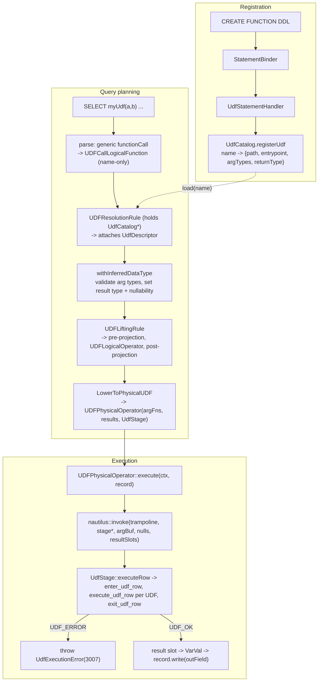
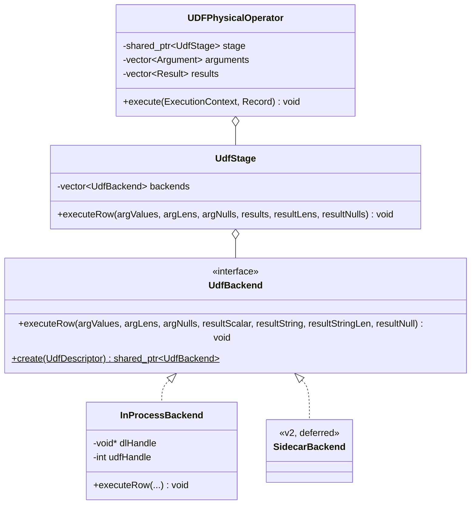

# The Problem

NebulaStream can evaluate a fixed catalog of built-in scalar functions (`Add`, `Concat`, `CHAR_LENGTH`, `FROM_BASE64`, ...) inside `SELECT` and `WHERE` expressions.
It can also register and run ML models through the `nes-inference` feature (`CREATE MODEL` + `MODEL_INFERENCE(...)`).
It has no way to run a *user-defined functions* (UDF). More specifically, Scalar UDFs are functions that take as input one tuple at a time and return a single value.

This document summarizes the key challenges and design goals specifically for supporting scalar UDFs in NES. This is considered version v1 for adding UDF support in NES.

P1: Adding any type of new function in NES requires modifying and recompiling the engine.
Functions require a `LogicalFunction`/`PhysicalFunction` pair in C++, along with an `add_plugin(...)` entry for enabling/disabling the plugin function and then rebuilding altogether.
Hence, a user who requires some simple -yet external- functionality such as currency conversion (e.g. `to_euro(amount, ccy)`) cannot get it without a source change to NebulaStream.

P2: New functions added in NES must be written in the engine's native language, which is C++. There is no path for functions authored in another language and yet many users either prefer or need code written in non-C++ languages to support their use-cases.
Data-science users typically express business logic in Python, but NebulaStream exposes no boundary at which such code can be plugged in.

P3: Plugging in external, user-supplied code might fail at runtime in ways the engine currently has no facility to contain.
A UDF can raise, receive bad input, or even crash the process.
The engine must surface recoverable failures as query errors — with a diagnostic reaching the user — without the worker dying, and today no such loading-and-containment facility exists.

# Goals

G1 (addresses P1, P2): A user registers a precompiled `.so` bridge to a scalar UDF through SQL DDL and calls it by name in any scalar expression, with no engine recompilation.
Registration declares the UDF's signature (argument types + return type), how it executes, and its entry point. The frontend resolves the `.so` bridge from the language and execution. A `.so` can no longer be named in SQL; the catalog API still takes a path.
Calling the UDF requires *no* query-side grammar change — `myUdf(a, b)` rides the existing generic function-call path.

G2 (addresses P2): The engine boundary is a language-agnostic C ABI.
The registered `.so` bridge needs only to export three C symbols.
At this moment, Python is the first target language, via a bridge `.so` that embeds an interpreter behind that ABI.

G3 (addresses P3): A recoverable UDF failure fails only the query, never the worker.
The failure carries a dedicated error code (`UdfExecutionError`) plus the underlying diagnostic (e.g. the Python traceback), and is delivered to the client.
This is assertable by negative systests (`ERROR 3007`).

G4: The feature mirrors the existing `nes-inference` structure — catalog, DDL, a name→resolved logical node, deferred load at lowering, and `nautilus::invoke` into a runtime object.

# Non-Goals

NG1: Containing *fatal* UDF crashes (segfault, `os._exit`, native `abort`) is out of scope for v1.
In-process execution cannot contain them (see [Proof of Concept](#proof-of-concept)), and the process-isolation machinery that can is a large subsystem (see A2).
v1 instead places a seam (`UdfBackend`) so that a v2 sidecar backend closes this gap without changing any layer above it.

NG2: Vectorized / batched execution is out of scope.
v1 is scalar, one row in and one value out.
The per-row GIL and per-row call-overhead ceilings, and the column-batch ABI that would relieve them, are deferred.

NG3: Aggregate, table, and window UDFs are out of scope — only scalar UDFs for v1.

NG4: Full NES type coverage is out of scope for v1.
v1 supports `BOOLEAN`, the integer widths (`INT8..INT64`, `UINT8..UINT64`), the float widths (`FLOAT32/64`), and `VARSIZED`.
`TIMESTAMP`, decimal, and `CHAR` are deferred and rejected at registration.

NG5: Sandboxing untrusted UDF code and privacy rules beyond process isolation (resource limits, seccomp, filesystem/network confinement) is out of scope.

NG6: Per-UDF interpreter/environment selection is out of scope for v1. Each bridge embeds exactly one interpreter, resolved once at build time; a third-party-dependency venv (A7) is process-wide, not per-`CREATE FUNCTION`.

# Alternatives

## A1 — UDF as an operator (like inference) vs. as a physical function

`nes-inference` models inference as a whole operator (`InferModelPhysicalOperator`), a node in the query plan.
We could model a UDF the same way: a `UDFOperator` that consumes a record buffer and appends an output column.

Disadvantage: an operator cannot be nested inside an arbitrary expression.
`SELECT to_euro(amount, ccy) * 1.1 FROM ... WHERE to_euro(amount, ccy) > 100` needs the UDF to be a *function* in the expression tree, not a plan node.
Modeling it as an operator would fail G1 (call the UDF in *any* scalar expression).

Chosen: model the UDF as a function in the logical plan, usable anywhere a scalar function is. Only Inline UDFs stay physical functions: an optimizer rule pulls all others out of their expressions into a UDF operator, see [Extension — The UDF operator](#extension--the-udf-operator).
We still borrow inference's *catalog + name→resolved + deferred-load + `nautilus::invoke`* patterns; we just attach them to the function machinery instead of the operator machinery.

## A2 — In-process execution vs. sidecar process isolation

The registered `.so` can be loaded in two places.

A2a (in-process): the worker `dlopen`s the `.so` and calls it directly.
Advantage: minimal — one loaded handle, one `nautilus::invoke` trampoline, a single marshalling boundary, no new binary, no IPC.
Disadvantage: a *fatal* crash in the UDF (segfault, `os._exit`, native `abort`) takes down the worker; no `try/catch` can contain it (confirmed by the PoC).
Recoverable failures (exceptions, bad input, wrong return type) are still fully contained — the bridge catches them and returns an error, the worker survives, the query fails with a diagnostic.

A2b (sidecar): a separate process loads the `.so` and the worker talks to it over IPC.
Advantage: even a fatal crash kills only the sidecar; the worker survives, the query fails, the sidecar respawns — G3 in the strongest form.
Disadvantage: a whole extra subsystem — a new interpreter-hosting executable, a hand-rolled wire protocol, an IPC client with crash-detection/respawn/reaping, a *second* marshalling boundary, and interpreter-deployment plumbing — layered on top of a core that is ~90% shared with A2a.

Chosen: A2a for v1, behind a `UdfBackend` interface, with A2b as a documented v2.
A2a already satisfies G3 for every *recoverable* failure, which is the common case; only fatal native crashes remain, and those are NG1 for v1.
The `UdfBackend` seam makes v2 a localized change: `SidecarBackend` satisfies the same interface, so the catalog, DDL, logical function, resolution rule, lowering, `UDFPhysicalOperator`, exception code, and systests are all untouched when isolation is added.
This keeps the reversible-decision cost near zero while shipping a much smaller v1.

## A3 — Resolve the UDF name at parse time vs. a two-phase resolution rule

A UDF call `myUdf(a, b)` reaches `LogicalFunctionProvider::tryProvide`, which fails to find `myUdf` in the built-in registry.

A3a (parse-time): thread the `UdfCatalog` into the parser and resolve the descriptor there.
Disadvantage: the codebase deliberately keeps catalogs out of the parser — source names are also left unbound at parse and resolved by later rules, and `AntlrSQLQueryPlanCreator` holds no catalog.
This would break that layering invariant.

A3b (resolution rule): the parser builds a *name-only* `UDFCallLogicalFunction` placeholder, and an optimizer rule (`UDFResolutionRule`, holding the catalog) later attaches the resolved `UdfDescriptor` — exactly how `InferModelResolutionRule` upgrades `InferModelNameLogicalOperator` to `InferModelLogicalOperator`.

Chosen: A3b.
It matches both the model-inference precedent and the source-binding precedent, and it keeps type inference catalog-free (the function validates against the stored descriptor).
Known cost: `LogicalOperator` has no generic "map all my functions" accessor, so the rule reaches into the operator types where scalar UDFs appear (`Selection` for `WHERE`, `Projection`/`Map` for `SELECT`) for the MVP and generalizes later.

## A4 — Route physical-function creation through the registry vs. special-case in lowering

Built-in physical functions are created through `PhysicalFunctionRegistry`, keyed by the logical function's type name, with `PhysicalFunctionRegistryArguments{childFunctions, inputTypes, outputType}`.

A4a (registry): extend `PhysicalFunctionRegistryArguments` with a generic config channel carrying the `.so` path/entrypoint/signature.
Disadvantage: pollutes a shared, widely-used struct with a UDF-specific payload, for a single consumer.

A4b (special-case): `FunctionProvider::lowerFunction` already special-cases `FieldAccessLogicalFunction` and `ConstantValueLogicalFunction` before consulting the registry.
Add a third branch that reads the descriptor off the resolved `UDFCallLogicalFunction` and lowers the UDF directly. This is what Inline UDFs do; others reach lowering as a UDF operator.

Chosen: A4b.
It follows existing precedent, needs no change to shared registry types, and is the natural home for carrying non-generic metadata (a `.so` path) from logical to physical.

## A5 — Reuse the prototype ABI as-is vs. a cleaned-up ABI

The PoC ships a working 3-symbol ABI, but its README flags two production gaps: a NaN sentinel for NULL (in-band, lossy) and a 3-value type table (`string/int64/double`) far narrower than NES's types.

A5a (as-is): fastest — the existing bridge `.so` drops in unchanged.
Disadvantage: inherits the NaN-null ambiguity and the narrow type table, both of which we would have to break compatibility to fix later.

A5b (cleaned-up): keep the 3-symbol shape but add explicit per-value null flags (in and out), a full NES type-code table, and length-delimited (binary-safe) strings.

Chosen: A5b.
Explicit null flags remove the NaN ambiguity and correctly represent a NULL result distinct from a valid NaN.
Length-delimited strings fix the CFFI bytes-vs-str nuance the PoC surfaced (one bridge passed `str`, others used `bytes` keys).
The cost is updating the bridge, which we control.

## A6 — `CREATE FUNCTION` DDL vs. config-only registration

A6a (config/API only): populate the `UdfCatalog` at worker startup from a config file, with zero grammar change anywhere.
Disadvantage: no interactive registration; diverges from how models are registered.

A6b (`CREATE FUNCTION` DDL): a new DDL statement mirroring `CREATE MODEL`, plus the catalog.
This is the only grammar change, and it is confined to the DDL — calling a UDF still needs none.

Chosen: A6b, for parity with `CREATE MODEL` and an interactive registration experience.
A6a will also be integrated at some point because it enables more flexible usability, earlier warm-up for UDFBackend and more options to the optimzer.

## A7 — Third-party UDF dependencies: ship them vs. let the user point at a venv

A Python UDF (e.g. one running ONNX inference) may need packages beyond the stdlib (`onnxruntime`, `numpy`). Docker/nix ship none today.

A7a (bake into Docker/nix): add the package to the base images and the nix devshell.
Disadvantage: grows every image/closure for a dependency only some UDFs need, and pins its version to the engine's release cadence instead of the user's.

A7b (process-wide venv override): a `WorkerConfiguration` option (`worker.python_udf.venv`, `PythonUdfConfiguration` in `WorkerConfiguration.hpp`), set once when `SingleNodeWorker` is constructed — the one point production worker, REPL, and systest's embedded backend all pass through — which `setenv`s `NES_UDF_VENV`, read at bridge init alongside `NES_UDF_PATH`. The bridge scans `<venv>/lib/` for its one version-specific dir (`pythonX.Y`, whatever the venv's own creator named it) rather than assuming it matches the bridge's own linked Python, and prepends its `site-packages` to `sys.path`. A venv reuses the base interpreter's `libpython`, so this needs no ABI/grammar/catalog change on the bridge side — same mechanism as `NES_UDF_PATH` today, just surfaced through the existing worker-config system instead of a bespoke flag. Constraint that scanning cannot remove: a *compiled* extension inside the venv still needs to match the ABI of the CPython build the bridge links against — in-process embedding cannot get around that. A pure-Python-only venv has no such constraint and works regardless of version drift between venv and bridge. One venv covers every Python UDF in that worker process; `sys.modules` is process-global, so two UDFs needing conflicting versions of the same package cannot both be satisfied this way.

A7c (per-UDF `VENV` clause): extend `CREATE FUNCTION` with `VENV '<path>'`, threaded through `UdfDescriptor` and the ABI's `initialize_udf`, so different UDFs can name different venvs. Same ABI-match constraint as A7b, and the same `sys.modules` collision the moment two venvs diverge on a shared module name — the extra flexibility only partially escapes A7b's ceiling, at the cost of grammar + ABI + catalog changes.

Chosen: A7b for v1. No grammar/ABI/catalog change, mirrors `NES_UDF_PATH` exactly, and rides the existing worker-config mechanism rather than adding a new one — sufficient for the common case of one worker process and one set of Python dependencies. A7c stays a documented option if per-UDF isolation is later needed.

Granularity in practice: `worker.python_udf.venv` is read once, at `SingleNodeWorker` construction, ahead of any query that might load a Python UDF — into a process that embeds its interpreter once (`Py_InitializeEx`, one-shot). So switching venvs means starting a new process, not toggling mid-run — e.g. for `systest`, two separate invocations differing only in the trailing `-- --worker.python_udf.venv=<path>` (or its absence). This bites even *within* one systest invocation: `CONFIGURATION`/`GLOBALCONFIGURATION` can set a different `worker.python_udf.venv` per query, and each override group does get its own `SingleNodeWorker` — but the CPython bridge `.so` backing all of them is one process-wide `dlopen`, whose interpreter init (`std::call_once`) fires on the first Python UDF call and is shared by every `SingleNodeWorker` after that. Run two test groups needing different venvs (e.g. `PythonUdfVenv` and `PythonUdfOnnx`) in the same invocation and only whichever query happens to run first gets its venv; the rest silently share that same interpreter state. Confirmed empirically: `-g PythonUdfVenv PythonUdfOnnx` in one process fails whichever group's query lost the race, passes both when run as separate invocations. Being a worker option, it's a worker-config-side argument, so it belongs after `systest`'s `--` like every other `--worker.xxx` override, never before it. Default (option unset) is always whatever Python is local to the process running the bridge — the system's `python3` for a bare-metal worker, the Docker image's `python3` for a containerized one, never the host's. Docker adds a wrinkle bare-metal doesn't have: the venv directory must be reachable *inside* the container (bind-mounted, with `worker.python_udf.venv` given the in-container path, not the host path), and for any package with compiled extensions, built against that container's libc/Python ABI — a venv built on the host and mounted in works for pure-Python packages (e.g. `inflection`), but is not reliable for one with native extensions (e.g. `onnxruntime`). Safest: create the venv from inside the container, not outside it.

Gotcha with multiple dev containers (this repo has several: `local`, `local-tsan`, `local-asan`). They all bind-mount the same repo directory, but each has its own private `/tmp`. Build the venv under a container's `/tmp` and only that one container can see it -- a different container, or a fresh one spun up for the next run, gets `ModuleNotFoundError` as if no venv existed at all.

Fix: build the venv inside the bind-mounted repo path, e.g. `nes-systests/udf/.iree_venv`. That path is the same on the host and in every container.

Note: unlike `small_venv`, this venv is not committed -- it's large and tied to the container's ABI. Each dev/CI run has to build its own (`pip install iree-base-compiler iree-base-runtime onnx`, or `onnxruntime` for the ONNX variant) and pass its path via `--worker.python_udf.venv`.

# Solution Background

An isolated prototype at `../udf/poc_dlopen` (outside this repo) established the runtime mechanism and the failure model — see [Proof of Concept](#proof-of-concept).
The feature is deliberately shaped after `nes-inference`, whose relevant machinery is:
- `ModelCatalog` (`nes-inference/include/ModelCatalog.hpp`) — a name-keyed registry populated by a `CREATE MODEL` DDL handler.
- The two-phase `InferModelNameLogicalOperator` → `InferModelLogicalOperator` resolution via `InferModelResolutionRule`.
- Deferred heavy work at lowering (`LowerToPhysicalInferModel::apply`).
- `InferModelPhysicalOperator` holding a `std::shared_ptr` runtime object and calling into it via `nautilus::invoke`.

The physical-function machinery the UDF plugs into is:
- `PhysicalFunctionConcept` (`nes-physical-operators/include/Functions/PhysicalFunction.hpp`), whose sole method is `VarVal execute(const Record&, ArenaRef&) const` — no lifecycle hook, and no `ExecutionContext` (only the arena is passed by `MapPhysicalOperator`).
- The `nautilus::invoke` pattern for calling a C++ runtime function from compiled query code, as in `CastVarSizedToNumericPhysicalFunction` and `ToBase64PhysicalFunction`.

# Our Proposed Solution

## High-level overview

A UDF is registered like a model (a catalog + a DDL) but *executed* as a scalar function in the expression tree.
The single point at which isolation lives is a `UdfBackend` interface; v1 provides `InProcessBackend`.





## The C ABI (the language-agnostic boundary — G2)

New header `nes-udf/include/UdfAbi.h`, includable by the engine, the backend, and UDF authors:

```c
enum UdfTypeCode {  /* stable wire values; mirror DataType::Type */
  UDF_BOOL=0, UDF_INT8=1, UDF_INT16=2, UDF_INT32=3, UDF_INT64=4,
  UDF_UINT8=5, UDF_UINT16=6, UDF_UINT32=7, UDF_UINT64=8,
  UDF_FLOAT32=9, UDF_FLOAT64=10, UDF_VARSIZED=11, UDF_TIMESTAMP=12 /* deferred */ };
enum UdfStatus { UDF_ERROR=0, UDF_OK=1 };   /* NULL is a flag, not a status */

int  initialize_udf(const char* entrypoint, int argc,
                    const int* arg_type_codes, int return_type_code, char** errormessage);

int  execute_udf_row(int handle,
                     const void* const* arg_values, const long long* arg_lens, const int* arg_nulls,
                     void* result_scalar, char** result_string, long long* result_string_len,
                     int* result_null, char** errormessage);

void cleanup_udf(int handle);
```

Explicit `arg_nulls`/`result_null` replace the PoC's NaN sentinel (A5).
`arg_lens` + `result_string_len` make VARSIZED binary-safe (mapped to Python `bytes`).

## Registration (G1, A6)

The only grammar change is a `createFunctionDefinition` rule (mirroring `createModelDefinition`), plus `SHOW`/`DROP FUNCTION`.
`StatementBinder` produces a `CreateFunctionStatement`; a `UdfStatementHandler` (holding a `std::shared_ptr<UdfCatalog>`) validates and calls `UdfCatalog::registerUdf`.
The catalog is instantiated at the app entry points and threaded into the `QueryOptimizer` (for the resolution rule), exactly as `modelCatalog` is.

## Invocation, resolution, lowering (G1, A1, A3, A4)

Calling `myUdf(a, b)` needs no grammar change: it parses through the generic `functionCall` rule, and `LogicalFunctionProvider` returns a name-only `UDFCallLogicalFunction` placeholder when the built-in registry misses.
`UDFResolutionRule` attaches the `UdfDescriptor` from the catalog before type inference.
`UDFCallLogicalFunction::withInferredDataType` validates argument types/arity against the signature and sets the result type and nullability.
`UDFLiftingRule` then moves every call that is not Inline into a `UDFLogicalOperator`. `LowerToPhysicalUDF` builds its `UDFPhysicalOperator`, whose `UdfStage` calls `UdfBackend::create(descriptor)` per UDF (which, in v1, `dlopen`s the `.so` and calls `initialize_udf`).

## Execution (G1)

`UDFPhysicalOperator::execute(ctx, record)` mirrors `InferModelPhysicalOperator`'s raw-buffer marshalling, with a single boundary in v1:
it evaluates the arguments of all its UDFs into one scratch buffer (scalars inline, VARSIZED as pointer+length, plus a null-flag byte per argument), then makes one fixed-signature `nautilus::invoke` call regardless of arity.
The trampoline calls `UdfStage::executeRow(...)`, which calls each UDF's `execute_udf_row` through `InProcessBackend`.
A scalar result is read back into a `VarVal`; a VARSIZED result is copied out of the reply into arena-allocated memory (the "return size, then allocate, then copy" two-step used by `InferModel`/`ToBase64`, because the arena cannot be allocated from inside the trampoline).
A NULL result is honored via the result null flag.

NULL semantics are SQL's `CALLED ON NULL INPUT` in every mode: a NULL argument reaches the UDF as Python `None` (`arg_nulls` carries it across the ABI), and the UDF decides what to do with it. Results therefore cannot depend on the mode that runs a UDF. A UDF that does not guard against `None` raises on NULL input, which fails the query. A UDF may also return `None` from any input; the result is always nullable, and the result null flag carries it back.

## Error propagation (G3)

On a recoverable failure the backend throws `UdfExecutionError` (new code `3007`), carrying the bridge's formatted message.
The throw unwinds out of `nautilus::invoke`, through the compiled pipeline, to the engine's single catch site (`handleTask`, `nes-query-engine/Task.hpp`), which is the same path divide-by-zero (`ArithmeticalError`) and bad casts (`FormattingError`) already take.
The worker thread survives; only the query moves to `FAILED`.
`QueryLog` records the message + code, the gRPC status carries them, and the client reconstructs the `Exception`.
Two rules are load-bearing: never use `PRECONDITION`/`INVARIANT` on the UDF path (they `std::terminate`), and re-wrap any `std::exception`/pybind error at the backend boundary into `UdfExecutionError` (else it flattens to `UnknownException`/9999).

## How the goals are addressed

G1: registration by DDL + call with no grammar change + no recompile — met by the catalog, the single DDL rule, and the generic-function-call path.
G2: the C ABI is the boundary; Python rides in behind a bridge `.so`.
G3: recoverable failures throw `UdfExecutionError` and unwind to the existing catch site; the worker survives and the user sees `3007` + message; a negative systest asserts it.
G4: catalog, DDL, two-phase resolution, deferred load at lowering, and `nautilus::invoke` all mirror `nes-inference`.

# Proof of Concept

The prototype at `../udf/poc_dlopen` validated the runtime mechanism (`dlopen` → `dlsym` → C ABI → embedded interpreter → error via out-param) and, crucially, the failure model.
Its host loads the bridge with `RTLD_NOW | RTLD_GLOBAL`, resolves the three ABI symbols, and drives rows through a Python `converttoeuro(amount, ccy)`:

| Scenario | Python does | Result in C++ | Worker survives? |
| --- | --- | --- | --- |
| Happy path | returns a float | `UDF_OK`, value written | — |
| Explicit `raise` | `raise ValueError(...)` | `UDF_ERROR` + traceback message | **Yes** |
| Natural `KeyError` | bad dict lookup | `UDF_ERROR` + message | **Yes** |
| `os._exit(70)` | hard process exit | call never returns | **No** |
| NULL deref | SIGSEGV | signal kills process | **No** |

This is the evidence base for the design: any ordinary Python *exception* is fully recoverable in-process (supporting G3 for v1), while a *hard* failure is not (motivating NG1 and the v2 sidecar behind the `UdfBackend` seam).
The prototype also surfaced the ABI gaps that A5 fixes (NaN-null sentinel, narrow type table, bytes-vs-str) and the GIL serialization ceiling that NG2 defers.

# Summary

The problem is that NebulaStream cannot run a user-defined scalar function without an engine change (P1), has no cross-language extension boundary (P2), and no facility to load foreign code and contain its failures (P3).

The proposed solution registers a UDF like a model (catalog + `CREATE FUNCTION` DDL) but executes it as a scalar `PhysicalFunction`, so it is callable in any expression with no query-side grammar change (G1), across a language-agnostic C ABI with a Python bridge (G2); recoverable failures throw a dedicated `UdfExecutionError` that fails only the query while the worker survives (G3); and every structural choice mirrors `nes-inference` (G4).

Among the alternatives, the pivotal one is A2: we ship in-process for v1 and defer the sidecar, because in-process already meets G3 for all recoverable failures, the sidecar is a disproportionately large subsystem, and a `UdfBackend` seam makes adding it later a localized, no-regret change.
The remaining alternatives (A1 function-not-operator, A3 resolution-rule, A4 special-case lowering, A5 cleaned-up ABI, A6 DDL) each follow existing engine precedent, which keeps the reviewer surface small.
The solution meets G1, G2, and G4 fully, and G3 for the recoverable-failure class; the fatal-crash residue is the explicit NG1, closed in v2.

# Open Questions

OQ1: Interpreter deployment — the bridge `.so` needs a Python runtime and a resolvable module path (`NES_UDF_PATH`) on the worker host; how is this surfaced in worker config and packaged for CI?

OQ2: Build-gating the `Udf` systest group — the group needs a Python runtime and the example `.so`s present; do we mirror the `Inference`/IREE `ENABLE_..._TESTS` gate?

OQ3: Error semantics — v1 fails the *query* on a UDF error; do we also want an opt-in "map error to NULL and continue" mode per UDF?

OQ4: Where does `dlopen` run — lowering is assumed worker-side (like model compilation); confirm the `.so` path resolves on the worker in all deployment topologies.

OQ5: Interpreter choice per UDF — resolved. CPython is the only embedded interpreter. A PyPy bridge existed and was removed to focus on one embedded runtime.

# Extension — Codon as a catalog UDF backend

`CREATE FUNCTION f (...) RETURNS T EXECUTION INLINE ENTRYPOINT 'module.function'` registers a UDF that Codon compiles ahead of time into the query pipeline, instead of calling a bridge `.so` through the C ABI once per row.

- **Descriptor.** `UdfDescriptor` carries a `UdfLanguage` (`Python`) and a `UdfExecution` (`Inline`, `InProcess` or `OutOfProcess`, which is not available yet). An Inline UDF has no `.so`: `path` stays empty, and it needs at least one argument. `UdfBackend::create` refuses anything but InProcess descriptors.
- **Lowering.** `FunctionProvider` turns an Inline `UDFCall` into a `PythonPhysicalFunction`, whose body is the UDF's `AS` body or, for an entry point, a generated import and call. Modules are found on `python_udf_import_paths` plus `NES_UDF_PATH`, the search path the CPython bridge uses, so one directory of UDF modules serves every backend.
- **NULL semantics.** A nullable argument arrives as `Optional[T]`, which is `None` for NULL. The result is nullable.
- **Language subset.** The code is compiled by Codon, not run by an interpreter. It must stay within Codon's statically typed Python, and a `VARSIZED` value is a `str` (the CPython bridge passes `bytes`). `nes-systests/udf/pyudfs/portable_udfs.py` is written to be valid under CPython and Codon, which is what lets `PythonUdfBridgeComparison.test` compare both backends on one source.

# Extension — Function bodies in CREATE FUNCTION

Instead of `ENTRYPOINT`, a function can carry its code: `CREATE FUNCTION f (a INT64) RETURNS INT64 AS $python$ ... $python$`. The body runs as a function whose parameters have the declared argument names. `UdfDescriptor` holds it as an `InlineUdfSource`, so it travels with the plan and needs no file on the worker.

Code cannot be written inside a query expression: every UDF has a name in the catalog. Internally, a function or operator can be implemented as a UDF without the catalog, by building a `UDFCallLogicalFunction` from `UdfDescriptor::fromSource`.

# Extension — The UDF operator

A UDF has one of three executions, set by `EXECUTION` in `CREATE FUNCTION`:

- **`INLINE`** compiles it into the query pipeline, with Codon for Python. It stays in its expression, like a built-in function.
- **`IN_PROCESS`**, the default, runs it through a bridge `.so` loaded into the worker, such as embedded CPython.
- **`OUT_OF_PROCESS`** runs it in a separate Python process, the interpreter of `$NES_UDF_VENV` if set and `python3` otherwise. A crash of the process fails the query, not the worker.

An out-of-process operator exchanges whole batches with its process. `QueryDecomposition` splits it into a sink and a source on its node, connected by a bounded in-memory channel. The Arrow layout only exists in lowering, on the operator's node, so it never appears in the logical plan or crosses the network:

```
input (row) -> Emit (ARROW, with columns for the results) -> PythonProcess sink -> channel -> PythonProcess source -> Scan (ARROW) -> output (row)
```

Worker threads only queue buffers. The source thread owns the process and does one synchronous round trip per batch over a socket, and it keeps the metadata of the input buffer, so only the buffer and its VARSIZED payloads cross the socket. On `open`, it generates a Python wrapper with the column offsets of the Arrow layout baked in and sends it to the process. The wrapper calls each UDF once per row and writes the results into their columns of the same buffer, using only the standard library. Arguments that are NULL reach the UDF as `None`, and VARSIZED arguments are `bytes`. A VARSIZED result may be `bytes` or `str`. `NES_UDF_PATH` lists further directories for importing an `ENTRYPOINT` module.


`UDFLiftingRule` runs after the pushdown rules and rewrites selections and projections that call non-Inline UDFs:

```
SELECT inc(a + b) * 2 AS x FROM nums

PROJECTION(__UDF_CALL_1 * 2 as X)                 the original expressions, reading the results
  UDF(calls: [__UDF_CALL_1 = INC(__UDF_ARG_0)])   the calls, on fields and constants only
    PROJECTION(A, B, A + B as __UDF_ARG_0)        the arguments that have to be computed
      ...
```

A selection evaluates its predicate into a field the same way, filters on that field, and drops the helper fields with a projection above it.

**What ends up in one operator.** Calls run together in one operator if they share an execution, a language and a bridge library, and if none reads the result of another. A call that reads another call gets its own operator above it, as does a call that cannot be fused with the others. The same call on the same fields runs once per row, so a non-deterministic UDF used twice in a projection returns one value. A selection and a projection above it do not share calls.

**Fusing.** A `UDFPhysicalOperator` makes one call into its `UdfStage` per record. The stage brackets the `execute_udf_row` calls of all its UDFs with `enter_udf_row` and `exit_udf_row`, so CPython takes the GIL once per row rather than once per UDF. The stage has its own mutex, taken before the GIL: a thread holding the GIL could otherwise wait for a backend's mutex held by a thread waiting for the GIL. Each UDF still gets its own call across the ABI. Running a whole buffer in one call is a later step.

**Joins.** A join predicate needs both sides of the join, so it cannot read from an operator below the join. A non-Inline UDF in a join predicate fails the query with `QueryInvalid`.

# Appendix — implementation outline

Component split mirrors `nes-inference` / `nes-inference/runtime`:
- `nes-udf/` (light): `UdfAbi.h`, `UdfDescriptor` (reflectable), `UdfCatalog`.
- `nes-udf/runtime/` (`nes-udf-runtime`, does `dlopen`): `UdfBackend` interface + `InProcessBackend`; linked `PRIVATE` into `nes-physical-operators` next to `nes-inference-runtime`.
- v2 adds `nes-udf/sidecar/` (executable), `UdfWireProtocol.hpp`, `SidecarBackend`.
- `nes-python-udf/` (built with `NES_ENABLE_PYTHON_UDFS`, the default): everything that needs Codon or CPython. It plugs into two runtime registries: `UdfBridge` (in `nes-udf`, language and execution -> shipped library) and `UdfLowering` (in `nes-physical-operators`, UDF backend -> physical function). It holds the Codon-compiled `PythonPhysicalFunction` and the `Codon` lowering (`functions/`), the bridge libraries and their BRIDGE names (`bridges/`), and the Codon plugin SDK with the OpenBLAS/OpenCV plugins (`codon-sdk/`, `codon-plugins/`). Without it both registries lack the Python entries, so binding a BRIDGE or lowering a Python UDF fails with `PythonUdfsNotEnabled`, while `InProcess` UDFs (`CREATE FUNCTION ... FROM '<lib>'`) keep working.

Ordered build sequence:
1. ABI header + `nes-udf` skeleton + `UdfCatalog`/`UdfDescriptor` (+ reflection) + `UdfCatalogTest`.
2. `CREATE FUNCTION` grammar + `StatementBinder` + `UdfStatementHandler` + entry-point wiring + binder test.
3. `UDFCallLogicalFunction` + `LogicalFunctionProvider` fallback + `UDFResolutionRule` + `SemanticAnalyzer` wiring + logical test.
4. `UdfBackend`/`InProcessBackend` + `UDFLogicalOperator` + `UDFLiftingRule` + `UdfStage` + `UDFPhysicalOperator` + trampoline.
5. `EXCEPTION(UdfExecutionError, 3007, ...)` in `ExceptionDefinitions.inc` + type-mapping table.
6. `nes-systests/udf/` positive + negative (`ERROR 3007`) systests + build-gating.

Reuse for v2: `subprocess::Popen` (`nes-common/include/Util/Subprocess.hpp`, already used by `nes-inference/src/IreeTool.cpp`) for spawn + crash-detection — note its destructor does not reap the child and `communicate()` is one-shot.

A detailed, file-by-file implementation plan (with `file:line` anchors) is kept alongside this document during implementation.
