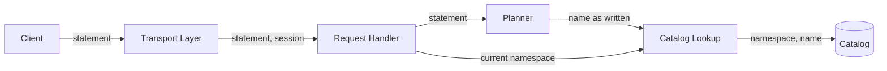
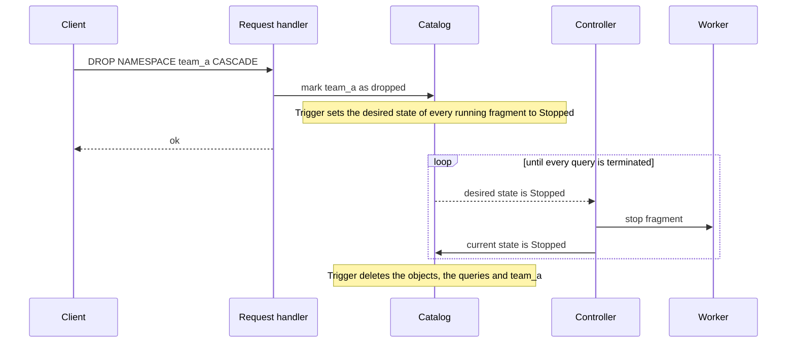
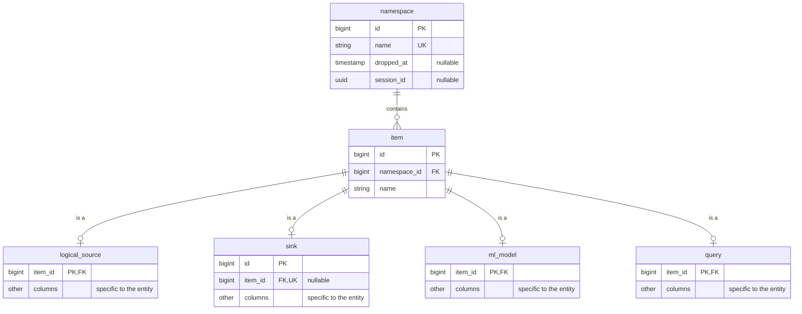

# The Problem

The system catalog stores user-defined objects such as sources, sinks, models and queries in a table each.
The respective table enforces unique names within the entity.
A request to the system (e.g., `CREATE LOGICAL SOURCE stream ...`) contains a single statement without information about its sender.
The coordinator therefore interprets every statement in one global context.

**P1**: Names of different entities can collide.
A source and a sink can have the same name, because each table enforces uniqueness.
It is confusing when statements like this are allowed: `SELECT * FROM orders INTO orders`.

**P2**: Two clients of one coordinator cannot use the same name.
The systests are the first such clients.
We run one coordinator for all test files of a systest invocation, and each file declares its own objects (with lots of collisions across files!).
The systests have a rewriter that prefixes every declared name: `stream` in `Join.test` becomes `JOIN_STREAM`.
For readable output, these prefixes need to be removed from explained plans and test result messages.
This is a lot of additional complexity that only exists for collision prevention.

**P3**: The coordinator has no notion of a client.
It handles every statement in isolation and cannot attribute a statement to a client.
It therefore has no place for state that belongs to one client, e.g., a current namespace, an identity or settings.
Several features depend on such state: access control, settings per client, and objects that the coordinator removes when their client disconnects.

# Goals

**G1**: A `NAMESPACE` is a catalog object that a client can `CREATE`, `DROP` and `SHOW`. (P2)

**G2**: Every user-defined object (`source`, `sink`, `ml_model` and `query`) belongs to **exactly one** namespace. (P2)

**G3**: Within one namespace, a name is unique across all these entities. (P1)

**G4**: A `Session` is coordinator-side state for a single client, storing information such as the current namespace. (P2, P3)

**G5**: A statement can refer to an object by its short `name` or by its qualified name `namespace.name`.
The coordinator resolves a short name in the current namespace of the client. (P2)

**G6**: A default namespace exists.
Clients that do not use namespaces observe today's behavior, except that a name is unique across all entities (G3).

**G7**: The system tests no longer prefix names on their own. (P2)

**G8**: A client can create a temporary namespace that is dropped by the coordinator when the client's session ends. (P3)

# Non-Goals

**NG1**: Namespaces for workers.
They describe the topology that all namespaces share.

**NG2**: Isolation of data or resources.
A namespace scopes names only.

**NG3**: Access control.
Roles, privileges and authentication are follow-up work.

**NG4**: A third level above the namespace.
The long-term scheme I propose is `application.namespace.name`.
No current requirement needs the third level.

# Solution Background

## Clients and Sessions

A **client** is a program that sends statements to a database system, e.g., a shell or an application.
It opens a **connection**, sends statements one after another, and closes the connection.

The statements of one client may depend on each other.
Often, a client sets a value and expects later statements to use it:

```sql
SET timezone = 'UTC';
SELECT now();
```

The second statement returns the current time in UTC, because the first one set the time zone for this client.
Another client that never set a time zone gets the time in the default time zone of the system.

The system therefore stores state for each client.
This state is the **session**.
It typically contains the identity of the client, its settings, and its position in the catalog (see below).

A session begins when the client connects and ends when it disconnects.
The system then discards the state.

## Namespaces

The **catalog** stores which objects exist in the system, e.g., tables and views, and how they are defined.
All clients share one catalog.

A **namespace** is a container for objects in the catalog.
A name is unique within its namespace, and two namespaces can each contain an object of the same name.
PostgreSQL calls a namespace a *schema*.

```sql
CREATE SCHEMA sales;
CREATE SCHEMA support;
CREATE TABLE sales.orders (id INT);
CREATE TABLE support.orders (id INT);
```

The **qualified name** of an object consists of its namespace and its name, e.g., `sales.orders`.
In PostgreSQL, every schema belongs to a *database*, which is one level above the schema: `database.schema.table`.

Namespaces have three uses:

1. Two users choose names without knowing the names of the other.
2. A user lists or drops the objects that belong together in one statement.
3. A privilege on a namespace decides who may see or create the objects in it.

A namespace scopes only names.
It does not isolate data or resources.

A **temporary** object exists only during one session.

```sql
CREATE TEMPORARY TABLE scratch (id INT);
```

PostgreSQL puts the table into a namespace that belongs to the session, and removes it when the session ends.

## Name Resolution

A qualified name in every statement is verbose.
A session therefore stores a **current namespace**, and a client can write a **short name** without the namespace.

```sql
SET search_path TO sales;
SELECT * FROM orders;
```

The system resolves `orders` as `sales.orders`, because `sales` is the current namespace of this session.
In a session with the current namespace `support`, the same statement resolves to `support.orders`.

**Name resolution** is the step that maps a name in a statement to one object in the catalog.
It needs two inputs: the session provides the current namespace, and the catalog provides the objects.
The catalog contains only qualified names and does not depend on any session.

PostgreSQL generalizes the current namespace to a **search path**, which is an ordered list of namespaces.
A short name refers to the first namespace in the list that contains it.

The table compares a namespace and a session.

|            | Namespace               | Session                         |
|------------|-------------------------|---------------------------------|
| Belongs to | the catalog             | one client                      |
| Shared     | by all clients          | with nobody                     |
| Lifetime   | until a client drops it | until the client disconnects    |
| Contains   | objects                 | the current namespace, settings |

A session refers to a namespace, and several sessions can have the same current namespace.
Changing the current namespace of a session changes nothing in the catalog.

# Our Proposed Solution

We add two things to the coordinator: namespaces in the catalog, and sessions.

A namespace is a catalog object that contains all named, user-defined entities.
A session stores the current namespace of its client.
Every request is a tuple of (statement, session), where the session identifies the client.
The coordinator resolves each name declared/used in the statement in the current namespace of that session.

Three parts of the coordinator appear in this document.
The `RequestHandler` runs each statement in one transaction of the catalog.
The `StatementPlanner` parses a statement and resolves names identifying catalog objects.
The `Controller` reconciles the current state against the desired state of queries and workers by taking corrective action (e.g., starting a query fragment).
The catalog is implemented in a relational database, so it supports constraints, triggers, and transactions.



## Namespaces

A namespace has a unique name in the catalog.
Namespaces (except `TEMPORARY` ones) are durable, so they outlive the session in which they were created.
Namespaces do not nest, so a qualified name has two parts: `namespace.name`.

The catalog always provides the `default` namespace.
This namespace cannot be dropped, so a client can always work in it.
A client not knowing about namespaces therefore observes the behavior of today's system, with the exception that a name is unique across all entities (G3).

`logical_source`, `sink`, and `ml_model` rows have mandatory names defined at their creation: `CREATE LOGICAL SOURCE stream (ts UINT64);`. 
Queries are defined with `SELECT ... FROM <source> INTO <sink>`. 
If the query does not declare a name, the coordinator generates one from a UUID.
A `physical_source` belongs to the namespace of its `logical_source`, and an anonymous or internal source or sink belongs to the namespace of its query.

## Sessions

A session is state in the coordinator that belongs to one client.
**Every** connection of a client with the coordinator is attached to a session.
A session is in-memory state and does not survive a coordinator crash.
You can imagine it (simplified) like this: 
```rust
struct Session {
    id: SessionId,
    namespace: String
}
```
Note that the session stores the name of the namespace, not its identifier ([S2](#sources-and-further-reading)).

### Using a Namespace

**Syntax**

```sql
USE <name>;
```

**Options and defaults**

`USE` has no options.
A session without a `USE` works in the namespace `default`.

**Behavior**

- The statement changes the current namespace of the session. It does not change the catalog.
- After checking the namespace exists, the `RequestHandler` applies it to the session.
- For each following statement, the coordinator resolves names in the context of this namespace, until it is a) dropped (`DROP NAMESPACE ...`), b) changed (`USE`), c) the session ends.
- The catalog does not know which sessions use a namespace, so one client can drop the current namespace of another (although running statements are protected via transactions).
- A failed `USE` leaves the session without a current namespace until a `USE` succeeds.
  A script that continues after the error then cannot create its objects in the previous namespace.

**Errors**

| Statement                                        | Fails if                                                                                    |
|--------------------------------------------------|---------------------------------------------------------------------------------------------|
| `USE team_a;`                                    | `team_a` does not exist, or it is marked as dropped.                                        |
| Every statement that needs the current namespace | The session has no current namespace, or no namespace has the name that the session stores. |

To make "every statement that needs the current namespace" correct and meaningful, we rely on two things: 
1. FIFO ordering in the `RequestHandler`.
2. Reliable, in-order delivery if the client reaches the coordinator over the network (e.g., via TCP or HTTP).

**Example**

```sql
-- Session 1: stores the name `team_a`.
USE team_a;

-- Session 2: deletes the namespace and creates a new one with the same name.
-- The new namespace has a new identifier.
DROP NAMESPACE team_a;
CREATE NAMESPACE team_a;

-- Session 1: the coordinator looks up `team_a` and finds the new namespace, so the statement succeeds.
-- A session that stores the identifier refers to the deleted namespace, so the statement would fail.
CREATE LOGICAL SOURCE orders(id UINT64 NOT NULL);
```

## Name Resolution

A name in a statement has either **one** or **two** parts (separated by a `.`).

| Name            | Namespace                            |
|-----------------|--------------------------------------|
| `orders`        | the current namespace of the session |
| `shared.orders` | `shared`                             |

A `CREATE` statement with a short name creates the object in the current namespace of the session.
With a qualified name, it creates the object in that namespace, as in PostgreSQL and Materialize.
`CREATE PHYSICAL SOURCE FOR <name>`, `DROP ... WHERE name = ...` and `SHOW ... WHERE name = ...` work the same.

The coordinator resolves a name used in a statement in two lookups, both **inside the transaction of that statement**:

1. the identifier of the namespace, by the name of the namespace,
2. the object, by the identifier of the namespace and the name of the object.

The statement fails if either lookup fails.

The `RequestHandler` passes each statement to the `StatementPlanner`.
The `Optimizer` calls a catalog lookup for each name in the statement and passes the name.
The lookup resolves the name with the namespace of the current session.
The `StatementPlanner` therefore does not depend on the session.

```sql
CREATE NAMESPACE shared;
CREATE NAMESPACE team_a;
CREATE LOGICAL SOURCE shared.orders(id UINT64 NOT NULL);
USE team_a;
CREATE SINK out(id UINT64 NOT NULL) TYPE File;
SELECT * FROM shared.orders INTO out;
```

For the last statement, the optimizer calls the catalog once for each name and passes the parts as written:

```cpp
/// The statement contains the namespace of the source.
catalog.getLogicalSource("shared", "orders");
/// The statement contains no namespace for the sink.
catalog.getSinkDescriptor("", "out");
```

The lookups of the catalog get the namespace as an additional parameter:

```rust
/// `namespace` is empty if the statement does not include one.
/// The lookup then uses the current namespace of the session, stored in `cx`.
fn get_logical_source(cx: &Transaction, namespace: &str, name: &str) -> LogicalSource;
fn get_sink(cx: &Transaction, namespace: &str, name: &str) -> Sink;
```

The first call returns `shared.orders` and the second one `team_a.out`, and the query belongs to `team_a`.

Errors and explained plans show each name as it is written in the statement.

```sql
USE team_a;
-- `orders` does not exist: the error has `orders`, not `team_a.orders`.
SELECT * FROM orders INTO out;
```

Materialize also resolves names through an interface that combines the catalog and the session ([S3](#sources-and-further-reading), [S4](#sources-and-further-reading)).

A field qualifier is the short name of its source, or its alias: `SELECT orders.id FROM shared.orders`.

## Statements

### Creating a Namespace

**Syntax**

```sql
CREATE [TEMPORARY] NAMESPACE [IF NOT EXISTS] <name>;
```

`<name>` is an identifier, as for a source or a sink.

**Options and defaults**

| Option          | Default | Effect                                                                     |
|-----------------|---------|----------------------------------------------------------------------------|
| `TEMPORARY`     | not set | The namespace belongs to the session and is dropped when the session ends. |
| `IF NOT EXISTS` | not set | The statement succeeds if a namespace of this name already exists.         |

**Behavior**

- The statement adds an empty namespace to the catalog.
- Every session can use the namespace from then on.
- The statement does not change the current namespace of the session.
- When its session ends, the coordinator drops a temporary namespace as `DROP NAMESPACE ... CASCADE`.
- Until then, a temporary namespace is a namespace like any other.

PostgreSQL hides the temporary namespace of a session from other sessions.
We do not (for now), because hiding a namespace is isolation (NG2).

**Errors**

A failed statement does not change the catalog.

| Statement                                  | Fails if                                                                                               |
|--------------------------------------------|--------------------------------------------------------------------------------------------------------|
| `CREATE NAMESPACE team_a;`                 | A namespace `team_a` exists.                                                                           |
| `CREATE NAMESPACE [IF NOT EXISTS] team_a;` | `team_a` is marked as dropped and not deleted yet (see [Dropping a Namespace](#dropping-a-namespace)). |

**Example**

```sql
CREATE NAMESPACE team_a;

CREATE TEMPORARY NAMESPACE scratch;
USE scratch;
CREATE LOGICAL SOURCE orders(id UINT64 NOT NULL);
-- The session ends: the coordinator drops `scratch` and its objects.
```

### Showing Namespaces

**Syntax**

```sql
SHOW NAMESPACES [WHERE <attribute> = <value>];
```

**Options and defaults**

`WHERE` is an option of every `SHOW` statement.

**Behavior**

- The statement returns one row for each namespace, including `default` and the temporary namespaces of all sessions.
- The result does not depend on the current namespace of the session.

**Example**

```sql
SHOW NAMESPACES;
SHOW NAMESPACES WHERE name = 'team_a';
```

### Dropping a Namespace

**Syntax**

```sql
DROP NAMESPACE <name> [CASCADE];
```

**Options and defaults**

| Option    | Default | Effect                                                                       |
|-----------|---------|------------------------------------------------------------------------------|
| `CASCADE` | not set | The statement also drops the objects of the namespace and stops its queries. |

**Behavior**

A **query fragment** is a part of a query that runs on one worker.
A query is **terminated** once it has completed, stopped or failed.

Without `CASCADE`:

- The statement deletes the namespace in its transaction.
- It fails if the namespace contains an object, including a terminated query, so the user drops each object first.

With `CASCADE`:

- If no query of the namespace is running and no running query of another namespace uses its objects, the statement deletes the namespace and its objects in its transaction.
- Otherwise, the statement marks the namespace as dropped and returns.
  The coordinator then stops the queries of the namespace, and each query of another namespace that uses an object of this namespace.
- Once all of these queries are terminated, a trigger in the catalog deletes the objects of the namespace, its queries and the namespace.
- From the mark until this deletion, a further `DROP NAMESPACE` of it, with or without `CASCADE`, succeeds without a change.
  Every other statement that refers to the namespace fails.
- The mark is stored in the catalog, so a restarted coordinator continues the drop.

**Errors**

A failed statement does not change the catalog.

| Statement                           | Fails if                                                |
|-------------------------------------|---------------------------------------------------------|
| `DROP NAMESPACE default [CASCADE];` | Always: `default` cannot be dropped.                    |
| `DROP NAMESPACE team_a [CASCADE];`  | `team_a` does not exist.                                |
| `DROP NAMESPACE team_a;`            | `team_a` contains a source, a sink, a model or a query. |

**Example**

```sql
USE team_a;
CREATE LOGICAL SOURCE orders(id UINT64 NOT NULL);

-- Fails: `team_a` contains a source.
DROP NAMESPACE team_a;

-- Drops `team_a` with its sources, sinks and models, and stops its queries.
-- Also stops a query of another namespace that reads `team_a.orders`.
DROP NAMESPACE team_a CASCADE;
```

**Sequence with `CASCADE`**



### Showing Objects

**Syntax**

```sql
SHOW <entity> [FROM <namespace>] [WHERE <attribute> = <value>];
```

`<entity>` is `QUERIES`, `LOGICAL SOURCES`, `SINKS` or `MODELS`.

**Options and defaults**

| Option             | Default                              | Effect                                               |
|--------------------|--------------------------------------|------------------------------------------------------|
| `FROM <namespace>` | the current namespace of the session | The statement returns the objects of this namespace. |

**Behavior**

- The statement returns one row for each object of the entity in the namespace.

**Errors**

| Statement                 | Fails if                                             |
|---------------------------|------------------------------------------------------|
| `SHOW SINKS FROM team_a;` | `team_a` does not exist, or it is marked as dropped. |

**Example**

```sql
USE team_a;
-- Returns the sinks of `team_a`.
SHOW SINKS;
-- Returns the sinks of `shared`.
SHOW SINKS FROM shared;
```

### Stopping and Dropping a Query

`STOP QUERY [WHERE ...]` stops the queries and keeps their rows, so a client can inspect a terminated query.
`DROP QUERY [WHERE ...]` also stops them, and deletes each row once its query has terminated.
Until then, the query keeps its name, and a `DROP NAMESPACE` without `CASCADE` fails.

## Catalog

The catalog gets two new tables.

`namespace` has a surrogate identifier and a unique name.
Its column `dropped_at` is empty until a `DROP NAMESPACE ... CASCADE` marks the namespace as dropped.
Its column `session_id` contains the identifier of the session that created a temporary namespace, and is empty for any other namespace.

`item` has one row for each object that belongs to a namespace.
A row contains the identifier of the object, the identifier of its namespace and its name.
The pair of namespace and name is unique in `item`, so a name is unique across all entities (G3).

The tables `logical_source`, `sink`, `ml_model` and `query` keep the columns that are specific to their entity.
Each of their rows refers to one row in `item` through the column `item_id`, which is also the primary key of the table.
`sink` is the exception: an anonymous or internal sink has no name and no row in `item`, so `sink` keeps its own primary key.
`item` does not store the entity of an object: an object is a sink if a row in `sink` refers to it.



Materialize stores the items of all entities in one table and refers to a namespace by its identifier ([S1](#sources-and-further-reading)).
Renaming a namespace then changes only one row.

## Session Lifetime and Transports

The coordinator stores all sessions in an in-memory map from the identifier of a session to its state.
Sessions are not part of the catalog, so a restart of the coordinator ends all of them.
The identifier is a random UUID that the coordinator generates.
A client holds a session handle that contains the identifier:

```rust
/// Begins a session in the default namespace.
fn connect(&self) -> SessionHandle;

/// Releasing the handle ends the session.
impl SessionHandle {
    /// Runs one statement in a transaction of the catalog.
    fn submit(&self, statement: &str) -> Result<Reply>;
}
```

The coordinator executes one statement at a time and the statements of a session run in FIFO order.

When a session ends, the coordinator drops the temporary namespaces of that session.
This stops the queries of these namespaces and the queries of other namespaces that use their objects.
Every other query outlives the session that created it.
At startup, the coordinator also drops the temporary namespaces of earlier runs.

A transport layer receives the statements of a client and passes each one to the request handler as a request.
Every request contains a statement and the identifier of its session.
The request handler does not depend on the transport:

| Transport | Session of a request                              |
|-----------|---------------------------------------------------|
| Embedded  | a session of the frontend                         |
| TCP       | a session per connection                          |
| REST      | a session with the identifier in the HTTP request |

### Embedded (i.e., single-tenant) Coordinator
The coordinator is part of a frontend process.
The frontend begins and ends sessions with calls to the coordinator.
A frontend with one user needs one session.
The system test runner begins one session per test file, so each part has its own current namespace.
A session ends at the latest when the coordinator shuts down.

### Standalone (i.e., multi-tenant) Coordinator
Several clients may connect to a shared coordinator, which has one session per client.
With TCP, a session begins when its client connects and ends when it disconnects.
With REST, a client begins and ends its session with a request.
A REST session also ends after a configured time without a request, and a client sends periodic requests to keep it.
A request with an unknown session identifier fails.
Whether the standalone coordinator uses TCP or REST is an open question.

## System Tests

The system test runner begins one session for each part of a test file.
It sends two statements on this session before the statements of the part.

```sql
CREATE NAMESPACE "operator/join/Join.test";
USE "operator/join/Join.test";
-- The statements of `Join.test`, unchanged.
```

- A test file contains no namespace statement and no prefixed name.
- The name of the namespace is the path of the test file relative to the discovery directory, as a quoted identifier, so it is unique.
  A file with several parts appends the index of the part: `"benchmark/Nexmark.test#1"`.
- The runner does not drop the namespaces, because the catalog of a systest invocation is in memory.
- Errors and explained plans show each name as written, so the expected results contain no namespace.
- The rewriter no longer prefixes names, and the code that removes the prefixes from the output is deleted (G7).
  The rewriter itself stays, because it has other uses.

## Solution vs. Goals

# Increments

Each increment is one pull request and works from the SQL statement down to the catalog.

| # | Increment                                                                                                                                                         | Goal               |
|---|-------------------------------------------------------------------------------------------------------------------------------------------------------------------|--------------------|
| 1 | Namespaces: `namespace` and `item` tables, every object in the current namespace, `CREATE NAMESPACE`, `SHOW NAMESPACES`, `USE`, session of the embedded frontend. | G1, G2, G3, G4, G6 |
| 2 | `DROP NAMESPACE` for an empty namespace.                                                                                                                          | G1                 |
| 3 | Several sessions: a client begins and ends a session, and the coordinator stores all of them.                                                                     | G4                 |
| 4 | Systests use one session and one namespace per test part, and the name prefixing is removed.                                                                      | G7                 |
| 5 | Qualified names: `namespace.name`, and `SHOW ... FROM <namespace>`.                                                                                               | G5                 |
| 6 | `DROP NAMESPACE ... CASCADE`, after cascading drops exist for sources, sinks and models.                                                                          | G1                 |
| 7 | Temporary namespaces, which the coordinator drops at the end of their session.                                                                                    | G8                 |

- In increment 1, a name becomes unique across entities, so tests and scripts that use one name for two entities are renamed.
- Increment 1 builds on #1577, which gives every query a name.
- Until increment 5, the parser rejects a name with two parts.
- Before increment 1: `CREATE ... IF NOT EXISTS` for every entity, `STOP QUERY` next to `DROP QUERY`, and the rejection of a name with two parts.
- Before increment 6: `DROP ... CASCADE` for sources, sinks and models.

# Proof of Concept

# Alternatives

**A1: No namespaces**
The system tests prefix names, and any other client could do the same.
One coordinator per client would also work, but the clients then share no objects.
Neither actually allows multi-tenancy, which is a core principle of NebulaStream.

**A2: The client holds the session**
Trino keeps the current namespace on the client: a response header sets it first, and the client sends it with every later request ([S5](#sources-and-further-reading)).
The coordinator would need no state per client.
The disadvantage is that it would never know when a client is gone, so it could not drop a temporary namespace (G8), and it has no place for state such as an identity (P3).
PostgreSQL, Materialize and the Flink SQL Gateway keep the session on the server ([S2](#sources-and-further-reading), [S6](#sources-and-further-reading)), as proposed here.

**A3: Three levels / nested namespaces**
PostgreSQL, Materialize and Snowflake follow `database.schema.name`, Trino `catalog.schema.name`, and Flink `catalog.database.name`.
Spark and Iceberg nest namespaces to any depth, which is more complex.
No current requirement needs a level above the namespace (NG4), so we keep two levels and leave room for `application.namespace.name`.

**A4: Queries outside of namespaces**
ksqlDB identifies a persistent query by a generated identifier, which `TERMINATE` takes ([S7](#sources-and-further-reading)), and a Flink job is not a catalog object.
We put queries into namespaces, so that the query names of two clients do not collide (P2), and `DROP NAMESPACE ... CASCADE` finds the queries to stop.
Furthermore, we want to support piping queries together, so we need to give them a permanent home in the catalog.

**A5: Temporary objects instead of temporary namespaces**
PostgreSQL and Materialize mark a single object as temporary and put it into a schema of its session, which other sessions cannot use ([S8](#sources-and-further-reading)).
A temporary namespace needs one statement per session, leaves every `CREATE` statement unchanged, and reuses `DROP NAMESPACE ... CASCADE` at the end of the session.
Other sessions can see and use it, because hiding it would be isolation (NG2).

**A6: A search path**
PostgreSQL and Materialize resolve a short name in an ordered list of schemas.
MySQL (`USE`) and Snowflake (`USE SCHEMA`) set a single current namespace, as we do.
One namespace is enough for every goal, and a search path can extend it later without a change to the catalog.

**A7: Keep the previous namespace after a failed `USE`**
MySQL keeps the current database when `USE` fails.
We leave the session without a current namespace, so a script that continues after the error fails, and does not create its objects in the previous namespace.

**A8: A synchronous `DROP NAMESPACE ... CASCADE`.**
PostgreSQL drops a schema and its objects in one transaction.
Our drop requires RPCs to workers to terminate queries, and after that we need to await graceful termination. 
All together, this might take seconds to minutes of time.
The `RequestHandler` executes one statement at a time, so waiting for network round-trips adds head-of-line blocking.
The statement therefore marks the namespace, and a trigger deletes it once its queries have terminated.

# Summary

# Open Questions

# Sources and Further Reading

- **S1**: Materialize, durable catalog objects `Database`, `Schema` and `Item`: [`src/catalog/src/durable/objects.rs`](https://github.com/MaterializeInc/materialize/blob/1cab437b9027e814381c0ffd33f81af87d286e09/src/catalog/src/durable/objects.rs#L103)
- **S2**: Materialize, `Session`: [`src/adapter/src/session.rs`](https://github.com/MaterializeInc/materialize/blob/1cab437b9027e814381c0ffd33f81af87d286e09/src/adapter/src/session.rs#L74)
- **S3**: Materialize, `ConnCatalog`: [`src/adapter/src/catalog.rs`](https://github.com/MaterializeInc/materialize/blob/1cab437b9027e814381c0ffd33f81af87d286e09/src/adapter/src/catalog.rs#L273)
- **S4**: Materialize, `SessionCatalog`: [`src/sql/src/catalog.rs`](https://github.com/MaterializeInc/materialize/blob/1cab437b9027e814381c0ffd33f81af87d286e09/src/sql/src/catalog.rs#L89)
- **S5**: Trino, client protocol, headers `X-Trino-Schema` and `X-Trino-Set-Schema`: [trino.io/docs/current/develop/client-protocol.html](https://trino.io/docs/current/develop/client-protocol.html)
- **S6**: Flink, SQL Gateway, sessions and `sql-gateway.session.idle-timeout`: [nightlies.apache.org/flink/flink-docs-master/docs/dev/table/sql-gateway/overview](https://nightlies.apache.org/flink/flink-docs-master/docs/dev/table/sql-gateway/overview/)
- **S7**: ksqlDB, `TERMINATE`: [docs.ksqldb.io/en/latest/developer-guide/ksqldb-reference/terminate](https://docs.ksqldb.io/en/latest/developer-guide/ksqldb-reference/terminate/)
- **S8**: Materialize, temporary items and the schema `mz_temp` of each session: [`mz_adapter::catalog::state`](https://dev.materialize.com/api/rust/src/mz_adapter/catalog/state.rs.html)

# Appendix
