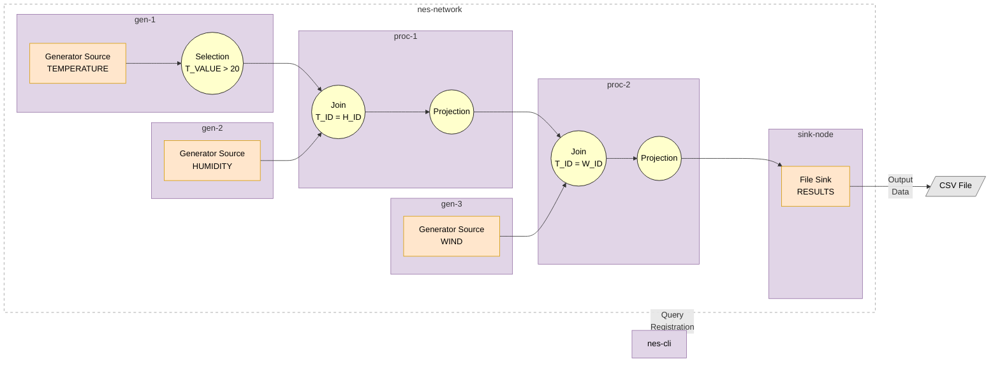

This walkthrough extends the [Quick Start](get_started.md) from one worker to six. It assumes that you have run the
Quick Start and know how to start a worker, write a [topology file](../guide/nebulastream-frontend.md#topology-file-format),
and submit a query with `nes-cli`. This page covers what changes in a distributed deployment: how workers are
connected, how they address each other, and where the parts of a query run.

This walkthrough runs all workers as Docker containers on a single machine.

## Scenario

Three generator workers each produce one stream of sensor readings: temperature, humidity, and wind. Every reading
has an ID, a value, and a timestamp. The query keeps the temperature readings above 20 degrees, joins them with the
humidity readings of the same ID, joins the result with the wind readings of the same ID, and writes the combined
readings to a file.



## Create a Network

All workers run as Docker containers in a shared network, so that they can reach each other by their container names:

```bash
docker network create nes-network
```

## Start the Workers

Start the three generator workers and the two processing workers:

```bash
for node in gen-1 gen-2 gen-3 proc-1 proc-2; do
  docker run -d --rm --name $node --network nes-network \
    nebulastream/nes-worker -- --grpc=0.0.0.0:8080 --data_address=$node:9090
done
```

Start the sink worker, which writes the results to `./output` as in the Quick Start:

```bash
docker run -d --rm --name sink-node --network nes-network \
  -v "$PWD/output:/output" \
  nebulastream/nes-worker -- --grpc=0.0.0.0:8080 --data_address=sink-node:9090
```

Compared to the Quick Start, each worker now also gets a `--data_address`. Workers exchange intermediate results over
this address, so it must be an address under which the other workers can reach the worker, here its container name.
See [Worker Options](../guide/nebulastream-frontend.md#worker-options) for details.

## Start the CLI

Start a `nes-cli` container in the same network and keep it running, as in the Docker Compose part of the Quick Start.
The current directory is mounted to `/catalog`, so the CLI can read the topology file from there. Because the
container keeps running, later `status` and `stop` calls can find the queries started by earlier calls.

```bash
docker run -d --rm --name nes-cli --network nes-network \
  -v "$PWD:/catalog" \
  --entrypoint /bin/sh nebulastream/nes-cli -c "tail -f /dev/null"
```

## Write the Topology File

Create a file called `topology.yaml` with the following content:

```yaml
query: |
  SELECT T_ID, T_VALUE, H_VALUE, W_VALUE
  FROM (
    SELECT T_ID, T_VALUE, T_TS, H_VALUE
    FROM (SELECT * FROM TEMPERATURE WHERE T_VALUE > FLOAT64(20))
    INNER JOIN (SELECT * FROM HUMIDITY) ON T_ID = H_ID
    WINDOW SLIDING(T_TS, H_TS, SIZE 1 SEC, ADVANCE BY 500 MS)
  )
  INNER JOIN (SELECT * FROM WIND) ON T_ID = W_ID
  WINDOW TUMBLING(T_TS, W_TS, SIZE 1 SEC)
  INTO RESULTS

workers:
  - host: gen-1:8080
    data_address: gen-1:9090
    downstream: [ proc-1:8080 ]
  - host: gen-2:8080
    data_address: gen-2:9090
    downstream: [ proc-1:8080 ]
  - host: gen-3:8080
    data_address: gen-3:9090
    downstream: [ proc-2:8080 ]
  - host: proc-1:8080
    data_address: proc-1:9090
    downstream: [ proc-2:8080 ]
  - host: proc-2:8080
    data_address: proc-2:9090
    downstream: [ sink-node:8080 ]
  - host: sink-node:8080
    data_address: sink-node:9090

logical:
  - name: TEMPERATURE
    schema:
      - { name: T_ID, type: UINT64 }
      - { name: T_VALUE, type: FLOAT64 }
      - { name: T_TS, type: UINT64 }
  - name: HUMIDITY
    schema:
      - { name: H_ID, type: UINT64 }
      - { name: H_VALUE, type: FLOAT64 }
      - { name: H_TS, type: UINT64 }
  - name: WIND
    schema:
      - { name: W_ID, type: UINT64 }
      - { name: W_VALUE, type: FLOAT64 }
      - { name: W_TS, type: UINT64 }

physical:
  - logical: TEMPERATURE
    host: gen-1:8080
    type: Generator
    parser_config: { type: CSV }
    source_config:
      generator_schema: SEQUENCE UINT64 0 6000 1, NORMAL_DISTRIBUTION FLOAT64 20 5, SEQUENCE UINT64 0 600000 100
      generator_rate_config: emit_rate 10
      seed: 1
      stop_generator_when_sequence_finishes: ALL
  - logical: HUMIDITY
    host: gen-2:8080
    type: Generator
    parser_config: { type: CSV }
    source_config:
      generator_schema: SEQUENCE UINT64 0 6000 1, NORMAL_DISTRIBUTION FLOAT64 50 10, SEQUENCE UINT64 0 600000 100
      generator_rate_config: emit_rate 10
      seed: 2
      stop_generator_when_sequence_finishes: ALL
  - logical: WIND
    host: gen-3:8080
    type: Generator
    parser_config: { type: CSV }
    source_config:
      generator_schema: SEQUENCE UINT64 0 6000 1, NORMAL_DISTRIBUTION FLOAT64 15 4, SEQUENCE UINT64 0 600000 100
      generator_rate_config: emit_rate 10
      seed: 3
      stop_generator_when_sequence_finishes: ALL

sinks:
  - name: RESULTS
    host: sink-node:8080
    type: File
    schema:
      - { name: T_ID, type: UINT64 }
      - { name: T_VALUE, type: FLOAT64 }
      - { name: H_VALUE, type: FLOAT64 }
      - { name: W_VALUE, type: FLOAT64 }
    config:
      output_format: CSV
      file_path: /output/results.csv
```

### What Is New Compared to the Quick Start?

- **`workers`** lists all six workers. `host` is the address under which the CLI reaches a worker, and
  `data_address` must match the `--data_address` the worker was started with. `downstream` defines the links of the
  topology, i.e., to which workers a worker can send data. There must be a path from each source's worker to the
  sink's worker.
- **`host`** of each physical source and of the sink selects the worker that runs it.
- **`generator_schema`** generates an ID, a normally distributed value, and a timestamp in milliseconds per reading;
  see [Generator Schema](../guide/sources-and-sinks.md#generator-schema). With `emit_rate 10`, each generator emits
  10 readings per second, so the timestamps, which advance by 100 ms per reading, follow the wall clock.
- **The query** joins three streams. The first join uses a
  [sliding window](../guide/operators.md#window-types) of one second that advances every 500 ms, the second join a
  tumbling window of one second. Each join adds the window bounds `START` and `END` to its output. The inner
  `SELECT T_ID, T_VALUE, T_TS, H_VALUE` drops them after the first join; otherwise they would collide with those of
  the second join. See [Join](../guide/operators.md#join).

## Check Where the Query Runs

Before starting the query, print its plans:

```bash
docker exec nes-cli nes-cli -t /catalog/topology.yaml dump
```

The output shows the plan of the query in three stages. `Initial Logical Plan` is the query as written,
`Optimized Global Plan` is the plan after optimization, and `Decomposed Plans` lists the part of the plan that runs on
each worker.

<details>
<summary>Expected Output</summary>

```text
== Initial Logical Plan ==

                                  SINK(RESULTS)
                                        │
              PROJECTION(fields: [T_ID, T_VALUE, H_VALUE, W_VALUE])
                                        │
                          Join(INNER_JOIN, T_ID = W_ID)
                         ┌──────────────┴─────────────────────────┐
PROJECTION(fields: [T_ID, T_VALUE, T_TS, H_VALUE]) WATERMARK_ASSIGNER(Event time)
                     ┌───┘                                    ┌───┘
       Join(INNER_JOIN, T_ID = H_ID)               PROJECTION(fields: [*])
                ┌────┴───────────────────────────┐            └──────────┐
 WATERMARK_ASSIGNER(Event time)   WATERMARK_ASSIGNER(Event time)   SOURCE(WIND)
                └───┐                            └───────────┐
        PROJECTION(fields: [*])                  PROJECTION(fields: [*])
                    └┐                                       └┐
          SELECTION(T_VALUE > 20)                     SOURCE(HUMIDITY)
                     └──────────────────┐
                               SOURCE(TEMPERATURE)

== Optimized Global Plan ==

                                  SINK(RESULTS)
                                        │
              PROJECTION(fields: [H_VALUE, T_ID, T_VALUE, W_VALUE])
                                        │
                          Join(INNER_JOIN, T_ID = W_ID)
                         ┌──────────────┴─────────────────────────┐
PROJECTION(fields: [H_VALUE, T_ID, T_TS, T_VALUE]) WATERMARK_ASSIGNER(Event time)
                        ┌┘                                      ┌─┘
         Join(INNER_JOIN, T_ID = H_ID)                    SOURCE(WIND)
                  ┌─────┴─────────────────────────────────┐
      SELECTION(T_VALUE > 20)              WATERMARK_ASSIGNER(Event time)
                  └────┐                                  └─────┐
        WATERMARK_ASSIGNER(Event time)                  SOURCE(HUMIDITY)
                       └────────────────┐
                               SOURCE(TEMPERATURE)

== Decomposed Plans ==
-- 1 plan(s) on gen-1:8080 --
0:

        SINK(NETWORK)
               │
   SELECTION(T_VALUE > 20)
               │
WATERMARK_ASSIGNER(Event time)
               │
     SOURCE(TEMPERATURE)


-- 1 plan(s) on gen-2:8080 --
0:

        SINK(NETWORK)
               │
WATERMARK_ASSIGNER(Event time)
               │
       SOURCE(HUMIDITY)


-- 1 plan(s) on gen-3:8080 --
0:

        SINK(NETWORK)
               │
WATERMARK_ASSIGNER(Event time)
               │
         SOURCE(WIND)


-- 1 plan(s) on proc-1:8080 --
0:

                  SINK(NETWORK)
                         │
PROJECTION(fields: [H_VALUE, T_ID, T_TS, T_VALUE])
                         │
          Join(INNER_JOIN, T_ID = H_ID)
            ┌────────────┴───────────┐
    SOURCE(NETWORK)          SOURCE(NETWORK)


-- 1 plan(s) on proc-2:8080 --
0:

                    SINK(NETWORK)
                          │
PROJECTION(fields: [H_VALUE, T_ID, T_VALUE, W_VALUE])
                          │
            Join(INNER_JOIN, T_ID = W_ID)
             ┌────────────┴─────────────┐
     SOURCE(NETWORK)            SOURCE(NETWORK)


-- 1 plan(s) on sink-node:8080 --
0:

 SINK(RESULTS)
       │
SOURCE(NETWORK)
```

</details>

NebulaStream decides the placement of the operators itself. The filter runs on `gen-1`, directly after the source,
so that only matching readings are sent over the network. Each join runs on the first worker that both of its input
streams pass through. `SINK(NETWORK)` and `SOURCE(NETWORK)` are the connections between the workers.

## Start the Query

```bash
docker exec nes-cli nes-cli -t /catalog/topology.yaml start
```

The CLI prints the query ID, e.g. `agile_hanoverian_5599`.

## Check the Output

After a few seconds, inspect the output:

```bash
head output/results.csv
```

```text
T_ID:UINT64:NOT_NULLABLE,T_VALUE:FLOAT64:NOT_NULLABLE,H_VALUE:FLOAT64:NOT_NULLABLE,W_VALUE:FLOAT64:NOT_NULLABLE
3,27.9138,41.1251,13.6321
5,21.288,43.0616,16.1138
9,24.2909,55.5424,12.556
8,20.3567,59.6366,10.2419
5,21.288,43.0616,16.1138
9,24.2909,55.5424,12.556
8,20.3567,59.6366,10.2419
13,24.4291,40.3438,19.6667
```

Only readings with a temperature above 20 appear. Most rows appear twice: the windows of the first join overlap,
so each reading falls into two of them and is joined once per window.

## Check the Status

```bash
docker exec nes-cli nes-cli -t /catalog/topology.yaml status <query-id>
```

The output contains the global status of the query and one entry per worker that runs a part of it, i.e., all six
workers (shortened here):

```json
[
  { "query_id": "agile_hanoverian_5599", "query_status": "Running" },
  { "worker": "gen-1:8080", "query_status": "Running" },
  { "worker": "gen-3:8080", "query_status": "Running" },
  { "worker": "gen-2:8080", "query_status": "Running" },
  { "worker": "proc-2:8080", "query_status": "Running" },
  { "worker": "sink-node:8080", "query_status": "Running" },
  { "worker": "proc-1:8080", "query_status": "Running" }
]
```

## Stop the Query

```bash
docker exec nes-cli nes-cli -t /catalog/topology.yaml stop <query-id>
```

Afterwards, `status` reports `Stopped` for the query and for every worker.

## Clean Up

Stop all containers and remove the network:

```bash
docker stop gen-1 gen-2 gen-3 proc-1 proc-2 sink-node nes-cli
docker network rm nes-network
```
