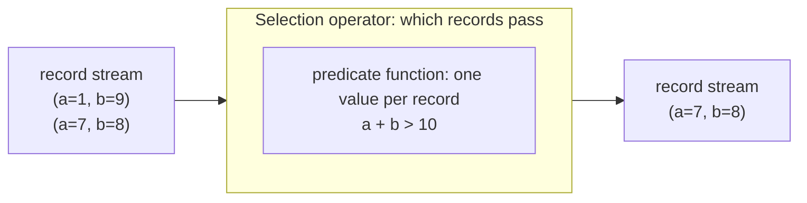

# How to add a `Function`

## 1. What is a Function

A function computes a single value from a single record and has no view of the stream.
It reads field values and constants, applies some logic, and returns one value.
The value is a single field, but that field may be of a composite type or hold variable-sized data such as text or an image.
Examples are `a + b`, `CHAR_LENGTH(name)`, and the CASE WHEN expression used as the example in this guide.

Functions appear inside operators.
The predicate of a Selection is a function that returns a boolean.
Each output column of a Projection is a function.
A join or aggregation uses functions to express keys and aggregated values.
Without functions an operator could only pass fields through unchanged, so functions are how a query expresses computation over the data.

### Function versus Operator

An operator and a function work at different levels.

- An operator works at the level of the stream. It decides which records pass, and how they are grouped, joined, filtered, or combined. It consumes and produces streams of records, windows, or tables.
- A function is evaluated once per record. Its input is one or more values from that record and its output is one value. It has no view of the stream.

Operators contain functions, and functions nest.
A Selection operator holds a predicate: a tree of functions that returns a boolean, for example an AND function whose children are two comparisons.
Each output field of a Projection is computed by such a function tree.
When you add arithmetic, a comparison, or a string operation to the system, you add a function, not an operator.



The operator sees the stream, the function sees one record and produces one value.

## 2. Planning and Execution

The planner (Apache Calcite, see `nes-calcite-planner`) checks the query and gives every expression its type.
The engine only executes the function: it gets the arguments and the result type from the plan.
Thus a function in the engine is one physical function and one registry entry.

The planner knows two kinds of functions:

- Functions of SQL and of Calcite's libraries (e.g. `+`, `CHAR_LENGTH`, `CASE`, `TIMESTAMP_MILLIS`). Calcite types them. You only add the physical function.
- Functions that SQL does not have (e.g. `FROM_BASE64`, `MEDIAN`). You also add their signature (see section 5). The planner offers them to queries with this signature.

## 3. Overview

Function plugins are implemented in the `nes-plugins/Functions/` directory.
For each new function, create a new directory, such as `nes-plugins/Functions/Conditional/`.
For our example, we use the following structure:

```
nes-plugins/
├── Functions/
│   ├── Conditional/
│   │   ├── CMakeLists.txt
│   │   ├── ConditionalPhysicalFunction.cpp
│   │   └── include/
│   │       └── Functions/
│   │           └── ConditionalPhysicalFunction.hpp
│   └── ...
├── Sinks/
├── Sources/
└── ...
```

## 4. Plugin Registration

The plugin's `CMakeLists.txt` builds a static library and adds an entry to the `PhysicalFunction` registry of nes-physical-operators:

```cmake
add_registry_entry(PhysicalFunction Conditional KEY Case)
```

The key is the name of the function in Substrait, the plan format between the planner and the engine (e.g. `add`, `is_not_null`, `extract`).
Lookups ignore the case of the key.
`CASE` is Substrait's `IfThen` expression, which the engine looks up under the key `case`, and a `CAST` under the key `cast`.
The registry calls the factory `create<Key>` of the class `<Name>PhysicalFunction`, thus `ConditionalPhysicalFunction::createCase` in the example.

Registration happens at runtime: the build only collects the declared entries, and the host process registers them when it loads the built-in plugins.

See `nes-plugins/Functions/Conditional/CMakeLists.txt` for the complete build setup of the example plugin.
To activate the plugin, add the line `add_plugin("Functions/Conditional")` to `nes-plugins/CMakeLists.txt`.

For a detailed explanation of the plugin system, CMake macros, and how registries work, see [guide/extensibility.md](extensibility.md).

## 5. Signatures of Functions That SQL Does Not Have

A function that SQL does not have also needs a signature class, `<Name>FunctionSignature` in `<Name>FunctionSignature.hpp`.
The class meets `FunctionSignatureConcept` (see `nes-physical-operators/registry/include/FunctionSignatureRegistry.hpp`):

```cpp
struct FromBase64FunctionSignature
{
    static constexpr std::array<std::string_view, 1> OPERANDS{"STRING"};
    static constexpr std::string_view RESULT = "VARBINARY";
    static constexpr bool AGGREGATION = false;
};

static_assert(FunctionSignatureConcept<FromBase64FunctionSignature>);
```

Register it in the `FunctionSignature` registry under the name of the function in SQL:

```cmake
add_registry_entry(FunctionSignature FromBase64 KEY FROM_BASE64)
```

The operands are Calcite's type families (`SqlTypeFamily`) and the result is a Calcite type (`SqlTypeName`).
The result is nullable if an operand is nullable.
Every plan request sends these signatures to the planner, which makes an operator for each.
The engine registers a scalar function under its lower-case name in the `PhysicalFunction` registry, and an aggregation under its name in the `AggregationPhysicalFunction` registry.

A function of Calcite's libraries that the Substrait conversion does not know needs a name for Substrait in `NesFunctions.SUBSTRAIT_NAMES` and a declaration in `nes_functions.yaml` (both in `nes-calcite-planner`).

## 6. Interface

A physical function can be any object that defines the following method:

```cpp
/// Evaluate the function on a record and return the result
VarVal execute(const Record& record, ArenaRef& arena) const;
```

To confirm the interface, add `static_assert(PhysicalFunctionConcept<T>);`.

## 7. Execution in the Physical Function

`execute` defines the runtime semantics of the function.
It receives one record and an arena for allocations, and returns the computed value as a `VarVal`.
nautilus traces this method to compile it into executable code, so the control flow you write becomes the control flow of the compiled query.

For the Conditional function, `execute` evaluates the conditions in order and returns the result of the first condition that holds, or the default if none hold.
`when.execute(record, arena)` returns a `VarVal` that serves as the branch condition.
`nautilus::static_iterable` walks the pairs at compile time, because the plan fixes the number of pairs.
Thus the loop becomes a straight sequence of branches in the compiled code.

```cpp
VarVal ConditionalPhysicalFunction::execute(const Record& record, ArenaRef& arena) const
{
    for (const auto& [when, then] : nautilus::static_iterable(whenThens))
    {
        /// A condition that is null is not true, so it does not select its branch. Converting the
        /// condition to a bool already accounts for that.
        if (when.execute(record, arena))
        {
            return withDeclaredType(then.execute(record, arena), resultType);
        }
    }
    return withDeclaredType(elseCase.execute(record, arena), resultType);
}
```

The child functions are themselves physical functions, so calling `execute` on a child evaluates a nested expression.
This is how a function such as `a + CHAR_LENGTH(name)` composes at runtime.

`withDeclaredType` rebuilds the returned `VarVal` with the result type of the plan, which is the type the enclosing operator's output schema expects.

## 8. Factory Functions

The registry calls the factory with `PhysicalFunctionRegistryArguments`:

- `childFunctions`: the arguments, as physical functions.
- `inputTypes`: the types of the arguments.
- `outputType`: the result type that the planner gave the call.
- `literals`: for each argument that is a literal or a Substrait enum, its text (e.g. the unit `DAY` of `EXTRACT`). Otherwise empty.

A function returns exactly `outputType`.
If the computation gives a different type (e.g. integer arithmetic in `INT32` for an `INT8` result), the factory adds a cast (see `castIntegerResult`).
The planner already checked the arguments, so a bad shape here is a bug of the planner and a precondition fits.
A function can also be a composition of other physical functions, e.g. `NOT_EQUAL` as `NOT (a = b)` (see `SqlPhysicalFunction.cpp`).

See the factory function in `ConditionalPhysicalFunction.cpp` for the example.

## 9. Example and Tests

The `Conditional` function used throughout this guide implements a CASE WHEN expression.
It evaluates condition and result pairs in order and returns the first matching result, or a trailing default.
The physical function stores the branches as (condition, result) pairs plus the default result.
The factory receives them as `[condition1, result1, ..., default]` and groups them into pairs.

Last, it is good practice to define tests for the function.
See `nes-systests/function/Conditional.test` for end to end tests that run queries against the function.
Which layer a given test belongs in, and what each layer is expected to cover, is described in [standards/testing_guidelines.md](../standards/testing_guidelines.md).
