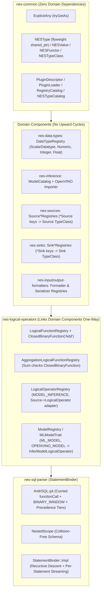

# Extensible Internal Type System, Registry Integration & Recursive Query Binder

## Goal Description

Finish and integrate NebulaStream's extensible internal type system (`NESType`, `NESValue`, `NESFunctor`, `NESTypeClass`, `NESParametrizedTypeClass`) across all plugin registries and into a unified, recursive `StatementBinder` that completely replaces the retired ANTLR-listener `AntlrSQLQueryPlanCreator` / `AntlrSQLQueryParser`.

This enables:
1. **Arbitrary plugin-defined objects & types in SQL**: Plugins expose first-class types and constructors (such as `OPENVINO_MODEL('/tmp/model.onnx' AS PATH, SCHEMA(...) AS INPUT, SCHEMA(...) AS OUTPUT)` or additional inference backends) alongside catalog-bound objects (`CREATE MODEL mnist ...`), passed uniformly through expressions and table-valued functions (`MODEL_INFERENCE(...)`) with zero hardcoded parser/binder logic.
2. **Polymorphic functions & type-class constraints (Collision-Free Unique Names, No Overload Sets)**:
   - **Trait-backed open type classes** (e.g., `ML_MODEL` via `MLModelTrait` so `MODEL_INFERENCE` works identically over `OPENVINO_MODEL`, catalog models, and any custom model backend plugin).
   - **Parameterized type constructors / scalar functors** (e.g., `DataType` functors parameterized by nullability, plus multi-parameter scalar functors like `FixedSizeArray(ScalarDatatype, Int)`).
   - **Structural / witness predicates** (e.g., `ClosedBinaryFunction("Add")` verifying via `NESFunctor::instantiate` that `Add(W, W) -> W` is defined on an aggregation's accumulator type).
   - **Collision-free registry keys & window clauses**: Source and sink registry keys are renamed everywhere (`FileSource`, `GeneratorSource`, `TCPSource`, `MQTTSource`, `NetworkSource` and `FileSink`, `VoidSink`, `PrintSink`, `ChecksumSink`, `TCPSink`, `MQTTSink`, `KafkaSink`, `NetworkSink` across CMake registrations, `CREATE ... TYPE ...`, inline SQL constructors, and YAML configs), and joins use `BINARY_WINDOW TUMBLING(...)` / `BINARY_WINDOW SLIDING(...)` (evaluated in a binary-window sub-scope) vs. `WINDOW TUMBLING(...)` on queries — eliminating cross-registry name collisions without overload sets or return-type SFINAE.
3. **Unified recursive `StatementBinder` + binder-side config resolution (`472415e9f1`)**:
   - Restores full binder-side `SourceConfigSchema` / `SinkConfigSchema` config resolution across `StatementBinder`, `StatementHandler`, `AnonymousSourceLogicalOperator`, `AnonymousSinkLogicalOperator`, `Systest` (`Rewriter` + `DataStaging` + `SystestBinder`), `CLIStarter`, `Repl`, and `ConnTest`.
   - Implements explicit recursive-descent query binding (`SELECT`, `FROM`, `JOIN`, `UNION`, `WHERE`, `WINDOW`, `GROUP BY`, `HAVING`, `INTO`) backed by `NestedScope` (`Schema<..., Unordered>`) and the `NESType` system, removing `InferModelNameLogicalOperator` and `InferModelResolutionRule`.

---

## Architecture Overview & Layering



> [!IMPORTANT]
> **Core Architectural Invariants**
> 1. **Zero CMake Library Cycles**:
>    - `nes-logical-operators` links `nes-inference`, `nes-sources`, and `nes-sinks` one-way. Placing `MLModelTrait` (which constructs `LogicalOperator`s), `ModelRegistry` (`ML_MODEL` + `OPENVINO_MODEL`), and `MODEL_INFERENCE` in `nes-logical-operators` keeps `nes-inference` free of `LogicalOperator`, while external model plugins link `nes-logical-operators` cleanly.
>    - `nes-sources` and `nes-sinks` expose `BoundAnonymousSource` (`Source` type class) and `BoundAnonymousSink` (`Sink` type class) under unambiguous keys (`FileSource`, `FileSink`, etc.) without referencing `LogicalOperator`, and `nes-logical-operators` / `StatementBinder` wraps them into `AnonymousSourceLogicalOperator` / `AnonymousSinkLogicalOperator`.
> 2. **Flyweight `NESType` Ownership**: `NESType` wraps an immutable `std::shared_ptr<const detail::NESTypeImpl>` whose raw value constructor returns `std::expected<ExplicitAny, Exception>`, wrapped into `NESValue{*this, std::move(rep)}` by `NESType::construct(...)`.
> 3. **Collision-Free 1:1 Scope Lookup**: Because sources (`*Source`) and sinks (`*Sink`) have distinct names and joins use `BINARY_WINDOW` with a dedicated binary-window sub-scope, every SQL symbol in `NESTypeCatalog` and `NestedScope` maps 1:1 to a single `NamedNESFunctor` or `NESValue` (`Schema<..., Unordered>`), with no overload sets.
> 4. **Per-Statement Streaming Bind + Execute**: `StatementBinder` provides a streaming `parseAndBindEach` / `ParsedProgram` API so multi-statement inputs (`CREATE MODEL m ...; SELECT * FROM MODEL_INFERENCE(m, ...) INTO s;`) bind each statement *after* prior DDL statements update the catalogs.

---

## Proposed Changes

### 1. Type System Core & Plugin Infrastructure (`nes-common`, `cmake`)

#### [MODIFY] [Any.hpp](file:///workspaces/nes1/nes-common/include/Util/Any.hpp)
- Add `template <typename T> [[nodiscard]] const std::remove_cvref_t<T>* tryGetAs() const noexcept` using `std::any_cast<std::remove_cvref_t<T>>(&value)` (fixing the `std::any_cast<const T*>` pointer-cast bug in WIP code).

#### [MODIFY] [NESType.hpp](file:///workspaces/nes1/nes-common/include/Types/NESType.hpp)
#### [MODIFY] [NESType.cpp](file:///workspaces/nes1/nes-common/src/Types/NESType.cpp)
- Remove self-include `#include "NESType.hpp"` and fix swapped `typeClassEquals` arguments.
- **`NESValue`, `NamedNESValue`, `NESValueParameters`**:
  - `NESValue(NESType type, ExplicitAny internalRepresentation)` with `getType()`, `getInternalRepresentation()`, `tryGetAs<T>()`, `getAs<T>()`, `operator==`.
  - `NamedNESValue(QualifiedIdentifier name, NESValue value)` + `NESValueParameters` supporting both positional (`std::vector<NESValue>`) and named (`Schema<NamedNESValue, Ordered>`) arguments, plus `bindAgainst(std::span<const QualifiedIdentifier>)` for unified positional/named SQL calls.
- **Flyweight `NESType` & `NamedNESType`**:
  - Backed by `std::shared_ptr<const detail::NESTypeImpl>` holding `ExplicitAny typeDescriptor`, `TraitMap` (`std::unordered_map<std::type_index, ExplicitAny>`), `valueConstructor` (`(const ExplicitAny&, const NESValueParameters&) -> std::expected<ExplicitAny, Exception>`), `typeEquals`, and `valueEquals`.
  - Provide `NESType::create<Descriptor, ValueRepr>(...)`, `.withTrait<Trait>(Trait)`, `.tryGetTrait<Trait>()`, `.hasTrait<Trait>()`, and `.construct(const NESValueParameters&) -> std::expected<NESValue, Exception>`.
- **`NamedNESTypeParameter`, `NESTypeParameters`, `ExpectedNESTypeArguments`**:
  - Unify `PassedNESTypeParameters` / `NESTypeParameters` naming; support positional and named type (`NESType`) and constant value (`NESValue`) parameters (`Schema<NamedNESTypeParameter, Ordered>` or positional vector).
  - `ExpectedNESTypeArguments` validates parameter count/names and `NESTypeClass` constraints returning `std::expected<void, Exception>`.
- **`NESTypeClass`, `NamedNESTypeClass`, `NESTypeClassParameters`, `NESParametrizedTypeClass`, `NamedNESParametrizedTypeClass`**:
  - `NESTypeClass`: `validate(const NESType&)`, `operator==`, `NESTypeClass::any()`, `NESTypeClass::forTrait<Trait>()`, `operator&&`, `operator||`.
  - `NESParametrizedTypeClass`: wraps descriptor + `instantiate(const NESTypeClassParameters& = {}) -> std::expected<NESTypeClass, Exception>` + `unparametrized()`.
- **`NESFunctor` & `NamedNESFunctor`**:
  - Stores `ExplicitAny structure` (holding `Registry::EntryType` for registry-backed functors), `typeStructureEquals`, optional `ExpectedNESTypeArguments`, and `typeConstructor` (`(const ExplicitAny&, const NESTypeParameters&) -> std::expected<NESType, Exception>`).
  - Fix `NamedNESFunctor::getUnderlyingFunctor()` to return `const NESFunctor&`; provide `NESFunctor::nullary<EntryT>(...)`.

#### [DELETE] [NESTypeRegistry.hpp](file:///workspaces/nes1/nes-common/registry/NESTypeRegistry.hpp)
#### [NEW] `nes-common/include/Types/NESTypeCatalog.hpp` & `nes-common/src/Types/NESTypeCatalog.cpp`
- Process-wide catalog (out-of-line `instance()` singleton, populated by `PluginLoader` during `loadBuiltinPlugins()`) storing:
  - Announced `NamedNESParametrizedTypeClass`es by case-insensitive `QualifiedIdentifier`.
  - Announced `NamedNESFunctor`s scoped by `(registryName, entryName)` and, for SQL-exposed registries (`exposeToSqlScope == true`), in a **collision-free** `Schema<NamedNESFunctor, Unordered>` global SQL functor table (throwing `CannotLoadPlugin` on any duplicate SQL functor name!).

#### [MODIFY] [RuntimeRegistry.hpp](file:///workspaces/nes1/nes-common/include/Util/RuntimeRegistry.hpp)
#### [MODIFY] [UnreflectionRegistry.hpp](file:///workspaces/nes1/nes-common/include/Util/UnreflectionRegistry.hpp)
- Add functor storage (`addFunctor` / `findFunctor` / `getRegisteredFunctors`) on `RuntimeRegistry` alongside `entries`.
- Provide default `static std::vector<NamedNESParametrizedTypeClass> getParametrizedTypeClasses() { return {}; }` and `static constexpr bool EXPOSE_TO_SQL_SCOPE = false;` (overridden to `true` on frontend-callable registries).

#### [MODIFY] [PluginDescriptor.hpp](file:///workspaces/nes1/nes-common/include/Plugins/PluginDescriptor.hpp)
#### [MODIFY] [PluginLoader.cpp](file:///workspaces/nes1/nes-common/src/Plugins/PluginLoader.cpp)
#### [MODIFY] [RuntimeRegistrationUtil.cmake](file:///workspaces/nes1/cmake/RuntimeRegistrationUtil.cmake)
```cpp
struct RegistryProvision
{
    QualifiedIdentifier registryName;
    const void* singletonIdentity = nullptr;
    bool exposeToSqlScope = false;
    std::vector<NamedNESParametrizedTypeClass> typeClasses;
    std::function<InsertResult(const NamedNESFunctor&)> insertEntry;
};
```
- Update `provideRegistry<Registry>(std::string_view name)` to set `singletonIdentity = &Registry::instance()` and convert `entry.getFullyQualifiedName()` to `Registry::KeyType`.
- Fix `PluginLoader::registerEntries` lookup to `RegistryCatalog::instance().find(entry.registryName)` and register `provision.typeClasses` and `entry.correspondingFunctor` into `NESTypeCatalog::instance()`.
- Update `create_runtime_registry` in `RuntimeRegistrationUtil.cmake` to accept optional `FUNCTOR_TEMPLATE` (defaulting to `makeDefaultNullaryRegistryFunctor<${REGISTRY_CLASS}>(${entry_template})`) and emit the updated `EntryProvision` struct literal.

---

### 2. Source & Sink Registry Key Rename + All 24 Plugin Registries

#### Global Source & Sink Registry Key Rename (`nes-sources`, `nes-sinks`, `nes-plugins`, `nes-query-optimizer`, `nes-query-compiler`, `nes-frontend`, `nes-systests`, `nes-conn-test`)
- Rename source registrations everywhere from `<Name>` to `<Name>Source`:
  - `File` -> `FileSource`, `Network` -> `NetworkSource`, `Generator` -> `GeneratorSource`, `MQTT` -> `MQTTSource`, `TCP` -> `TCPSource`.
- Rename sink registrations everywhere from `<Name>` to `<Name>Sink`:
  - `File` -> `FileSink`, `Print` -> `PrintSink`, `Network` -> `NetworkSink`, `Checksum` -> `ChecksumSink`, `Void` -> `VoidSink`, `TCP` -> `TCPSink`, `MQTT` -> `MQTTSink`, `Kafka` -> `KafkaSink`.
- Update internal C++ references (`NetworkSource` / `NetworkSink` in `QueryDecomposition.cpp`, `FileSource` / `FileSink` / `ChecksumSink` / `VoidSink` / `TCPSource` / `MQTTSource` in `Systest`, unit tests, `.test` files, `.sql` test files, `.nesql` conn-test files, and `.yaml` topology files).

#### Registry-by-Registry Type Class & Functor Matrix

| Component | Registry | Type Class(es) Exposed | `EXPOSE_TO_SQL_SCOPE` & Functor Behavior |
|---|---|---|---|
| `nes-data-types` | `DataTypeRegistry` | `ScalarDatatype`, `NumericDatatype`, `IntegerDatatype`, `FloatDatatype` | `true` — Optional `NULLABLE` type param; `NESType` carries `DataType` + `ScalarTypeTrait`; `construct(val)` creates typed constant (`UINT32(5)`, `VARSIZED('abc')`), rejecting `!= 1` args (`InvalidQuerySyntax`). |
| `nes-logical-operators` | **[NEW]** `ModelRegistry` | `ML_MODEL` | `true` — `OPENVINO_MODEL` functor accepts `(PATH, INPUT, OUTPUT)` (positional or named `SCHEMA(...)`), calls `RegisteredModel::create`, and returns `NESValue` with `MLModelTrait` (`getSchema`, `createInferenceOperator -> InferModelLogicalOperator`). |
| `nes-logical-operators` | `LogicalOperatorRegistry` | `LogicalOperator` (param: optional output `Schema`) | `true` — Registers `InferModel` under key `MODEL_INFERENCE` taking `(MODEL: ML_MODEL, STREAM: LogicalOperator)` -> delegates to `MLModelTrait::createInferenceOperator`. |
| `nes-logical-operators` | `LogicalFunctionRegistry` | `LogicalFunction`, `ClosedBinaryFunction` | `true` — Polymorphic `NESFunctor`s over child `LogicalFunction` / `ScalarDatatype` args; instantiates via `withInferredDataType`. Fix `Add`/`Sub`/`Mul`/`Modulo` `withInferredDataType` to require `isNumeric()` so `Add(VARSIZED, VARSIZED)` fails cleanly. |
| `nes-logical-operators` | `AggregationLogicalFunctionRegistry` | `AggregationLogicalFunction` | `true` — Polymorphic functors (`Sum`, `Count`, `Min`, `Max`, `Avg`, `Median`). `Sum` defers `UNDEFINED` unbound inputs and checks `ClosedBinaryFunction("Add")` on widened accumulator type `W` (`INT64`/`UINT64`/float/custom) in `withInferredType` (throwing `UnsupportedQuery` on failure). |
| `nes-sources` | `SourceConfigSchemaRegistry` | `Source` (via `BoundAnonymousSource`), `SourceConfigSchema` | `true` — Keys `FileSource`, `GeneratorSource`, `TCPSource`, `MQTTSource`, `NetworkSource` resolve named config args via `SourceCatalog::getConfigSchema` into `BoundAnonymousSource` (wrapped into `AnonymousSourceLogicalOperator` in `StatementBinder`). |
| `nes-sources` | `SourceRegistry`, `SourceConfigRegistry` | `PhysicalSource`, `SourceConfig` | `false` — Nullary backend functors. |
| `nes-sinks` | `SinkConfigSchemaRegistry` | `Sink` (via `BoundAnonymousSink`), `SinkConfigSchema` | `true` — Keys `FileSink`, `ChecksumSink`, `VoidSink`, `PrintSink`, `TCPSink`, `MQTTSink`, `KafkaSink`, `NetworkSink` resolve named config args via `SinkCatalog::getConfigSchema` into `BoundAnonymousSink` (wrapped into `AnonymousSinkLogicalOperator` in `StatementBinder`). |
| `nes-sinks` | `SinkRegistry`, `SinkConfigRegistry` | `PhysicalSink`, `SinkConfig` | `false` — Nullary backend functors. |
| `nes-input-formatters` | `InputFormatIndexer`, `InputFormatterConfigSchema`, `InputFormatterConfig`, `ValueDeserializer` | `InputFormatter`, `InputFormatterConfigSchema`, `InputFormatterConfig`, `ValueDeserializer` | `false` — Nullary / config-param backend functors. |
| `nes-output-formatters` | `OutputFormatter`, `OutputFormatterConfigSchema`, `OutputFormatterConfig`, `ValueSerializer` | `OutputFormatter`, `OutputFormatterConfigSchema`, `OutputFormatterConfig`, `ValueSerializer` | `false` — Nullary / config-param backend functors. |
| `nes-physical-operators` | `PhysicalFunction`, `AggregationPhysicalFunction` | `PhysicalFunction`, `AggregationPhysicalFunction` | `false` — Typed `(inputTypes, outputType)` backend functors. |
| `nes-query-compiler` / `nes-query-optimizer` | `LoweringRuleRegistry`, `PlanRuleRegistry` | `LoweringRule`, `PlanRule` | `false` — Nullary backend functors. |
| Unreflection (4 registries) | `Trait`, `LogicalFunction`, `LogicalOperator`, `AggregationLogicalFunction` Unreflection | `{}` (`0` type classes) | `false` — Default internal nullary functor wrapper. |

#### Cleanup of Hardcoded Model Placeholder Operator & Rule
- **[DELETE]** [InferModelNameLogicalOperator.hpp](file:///workspaces/nes1/nes-logical-operators/include/Operators/InferModelNameLogicalOperator.hpp), [InferModelNameLogicalOperator.cpp](file:///workspaces/nes1/nes-logical-operators/src/Operators/InferModelNameLogicalOperator.cpp), [InferModelResolutionRule.hpp](file:///workspaces/nes1/nes-query-optimizer/include/Rules/Semantic/InferModelResolutionRule.hpp), [InferModelResolutionRule.cpp](file:///workspaces/nes1/nes-query-optimizer/src/Rules/Semantic/InferModelResolutionRule.cpp); remove `LogicalPlanBuilder::addInferModel(Identifier, ...)` and update [InferModelLogicalOperatorTest.cpp](file:///workspaces/nes1/nes-logical-operators/tests/InferModelLogicalOperatorTest.cpp).

---

### 3. Binder-Side Config Resolution (`472415e9f1`) & Frontend / Catalog Alignment

#### [MODIFY] [SourceCatalog.cpp](file:///workspaces/nes1/nes-sources/src/SourceCatalog.cpp)
- Add `"NATIVE"` input formatter support in `SourceCatalog::getConfigSchema` and `SourceConfigSchema::resolveConfigs` (mirroring `SinkCatalog.cpp`).

#### [MODIFY] [StatementBinder.hpp](file:///workspaces/nes1/nes-sql-parser/include/SQLQueryParser/StatementBinder.hpp)
- Update `CreatePhysicalSourceStatement` and `CreateSinkStatement` to hold resolved typed configs (`GeneralSourceConfig`, `PluginSourceConfiguration`, `InputFormatterDescriptor`, `GeneralSinkConfig`, `PluginSinkConfiguration`, `OutputFormatterDescriptor`).
- Keep `CreateWorkerStatement::maxOperators` + arbitrary dot-separated `.config` map; remove stray `#include <openvino/runtime/properties.hpp>` in `StatementBinder.cpp`.
- Provide unified `StatementBinder` constructors accepting `SourceCatalog`, `SinkCatalog`, `ModelCatalog`, `defaultConfigValues`, and `configTransformations`, plus `parseProgram` / `parseAndBindEach` for streaming multi-statement execution.

#### [MODIFY] [AnonymousSourceLogicalOperator.hpp](file:///workspaces/nes1/nes-logical-operators/include/Operators/Sources/AnonymousSourceLogicalOperator.hpp) & `.cpp`, [AnonymousSinkLogicalOperator.hpp](file:///workspaces/nes1/nes-logical-operators/include/Operators/Sinks/AnonymousSinkLogicalOperator.hpp) & `.cpp`, [AnonymousSourceBindingRule.cpp](file:///workspaces/nes1/nes-query-optimizer/src/Rules/Semantic/AnonymousSourceBindingRule.cpp), [AnonymousSinkBindingRule.cpp](file:///workspaces/nes1/nes-query-optimizer/src/Rules/Semantic/AnonymousSinkBindingRule.cpp)
- Migrate anonymous source/sink operators and semantic binding rules to typed `GeneralSourceConfig` / `PluginSourceConfiguration` / `InputFormatterDescriptor` and `AnonymousSinkSchema` / `GeneralSinkConfig` / `PluginSinkConfiguration` / `OutputFormatterDescriptor`.

#### [MODIFY] All 7 Call Sites Replacing `AntlrSQLQueryParser`
- [StatementHandler.hpp](file:///workspaces/nes1/nes-frontend/include/Statements/StatementHandler.hpp) & [StatementHandler.cpp](file:///workspaces/nes1/nes-frontend/src/Statements/StatementHandler.cpp)
- [CLIStarter.cpp](file:///workspaces/nes1/nes-frontend/apps/cli/CLIStarter.cpp), [Repl.cpp](file:///workspaces/nes1/nes-frontend/apps/repl/Repl.cpp), [ReplStarter.cpp](file:///workspaces/nes1/nes-frontend/apps/repl/ReplStarter.cpp)
- [DistributedPlanningTest.cpp](file:///workspaces/nes1/nes-frontend/tests/DistributedPlanningTest.cpp), [Binder.cpp](file:///workspaces/nes1/nes-conn-test/driver/Binder.cpp), [StatementBinderTest.cpp](file:///workspaces/nes1/nes-sql-parser/tests/StatementBinderTest.cpp), [SystestBinder.cpp](file:///workspaces/nes1/nes-systests/systest/src/SystestBinder.cpp)

---

### 4. SQL Grammar (`AntlrSQL.g4`), Recursive Query Binder & `Systest` Rewriter

#### [MODIFY] [AntlrSQL.g4](file:///workspaces/nes1/nes-sql-parser/AntlrSQL.g4)
1. **Lexer Fixes**:
   - Change `E : [eE];` -> `fragment E : [eE];`.
   - Unsigned `UNSIGNED_INT_LITERAL: DIGITS;` and `FLOAT_LITERAL: DIGITS EXPONENT | DECIMAL_DIGITS EXPONENT?;` (`fragment EXPONENT: E [+-]? DIGITS;`), handling unary `+`/`-` in parser rules.
   - Fix `UNION ALL?` parser rule, remove trailing `WS` from `INNER`, restore `BRACKETED_COMMENT`, and trim whitespace after `UNSIGNED` in `bindDataType`.
   - Add `nonReserved` rule into `identifier: IDENTIFIER | nonReserved;` so keywords like `input`, `output`, `text`, `sink`, `source`, `model`, `start`, `end`, `size`, `advance`, `ms`, `sec`, `path`, `type`, `format`, `version` remain valid unquoted identifiers.
2. **Parser Rules, `BINARY_WINDOW` & Precedence**:
   - `functionCall`: support 0-arg `()`, `(*)` (`COUNT(*)`), positional `functionCallArgument` (`openScalarExpression | openRelationalExpression | unionSeq`), and named `functionCallArgument AS qualifiedIdentifier`.
   - Direct left-recursive 8-tier precedence in `openScalarExpression` (`primary/.`, unary `+/-`, `* / %`, `+ -`, comparisons + `IS [NOT] NULL|NAN` + `[NOT] BETWEEN` + `[NOT] IN` + unsupported-predicate hooks, `NOT`/`!`, `AND`, `OR`).
   - **Unambiguous Join Window**:
     ```antlr
     joinRelationalExpression: closedNamedRelationalExpression inbuildJoins closedNamedRelationalExpression ON openScalarExpression binaryWindowTerm;
     binaryWindowTerm: BINARY_WINDOW windowSpec;
     windowTerm: WINDOW windowSpec;
     ```
     Where `windowSpec` supports both `functionCall`/`INTERVAL` (`TUMBLING(ts, INTERVAL 1 SECOND)` / `TUMBLING(ts1, ts2, INTERVAL 1 SECOND)`) and legacy `SIZE <expr> <unit>` / `ADVANCE BY <expr> <unit>` (including ingestion-time 0-timestamp `BINARY_WINDOW TUMBLING(SIZE 1000 MS)` and `WINDOW TUMBLING(SIZE 1000 MS)`).
   - `query`: `projectionTerm fromTerm filterTerm? (windowTerm groupByTerm? | groupByTerm windowTerm?)? havingTerm?` and `intoTerm: INTO sink (COMMA sink)*;`.
   - `typeDefinition`: supports both built-in `DATA_TYPE` and parameterized type constructors `identifier ('(' typeParameter (',' typeParameter)* ')')?`.
   - Restore `SHOW VERSION`, `SHOW WORKER STATUS`, `SHOW PHYSICAL SOURCES FOR <id>`, and non-nullable `CREATE MODEL` fields.

#### [MODIFY] [StatementBinder.cpp](file:///workspaces/nes1/nes-sql-parser/src/StatementBinder.cpp)
- Implement explicit recursive-descent query binding backed by collision-free `NestedScope` (`Schema<..., Unordered>`) and `NESType` / `NESValue` / `NESFunctor`:
  - Root scope contains all SQL-exposed `NamedNESFunctor`s (`*Source`, `*Sink`, `DataType`s, `LogicalFunction`s, `AggregationLogicalFunction`s, `OPENVINO_MODEL`, `MODEL_INFERENCE`) plus live `ModelCatalog`, `SourceCatalog`, and `SinkCatalog` entries.
  - `windowTerm` evaluates in a unary-window sub-scope (`TUMBLING`, `SLIDING` -> `UnaryWindowDefinition`); `binaryWindowTerm` evaluates in a binary-window sub-scope (`TUMBLING`, `SLIDING` -> `BinaryWindowDefinition`).
  - Preserve exact NES semantics for raw vs. typed string/numeric literals, binary left-folded `UnionLogicalOperator` (only when `queries.size() > 1`), pre-aggregation `_agg_input_N` desugaring, auto-generated aggregation names, post-aggregation arithmetic, 0-agg windows, `GROUP BY` validation, and `HAVING` alias hints.

#### [MODIFY] `Systest` Rewriter, `DataStaging` & Test Files (`nes-systests`, `nes-frontend`, `nes-plugins`)
- Update [SqlParse.cpp](file:///workspaces/nes1/nes-systests/systest/src/Rewriter/SqlParse.cpp), [SourceRewriting.cpp](file:///workspaces/nes1/nes-systests/systest/src/Rewriter/SourceRewriting.cpp), [SinkRewriting.cpp](file:///workspaces/nes1/nes-systests/systest/src/Rewriter/SinkRewriting.cpp), [NamePrefixer.cpp](file:///workspaces/nes1/nes-systests/systest/src/Rewriter/NamePrefixer.cpp), [Emitter.cpp](file:///workspaces/nes1/nes-systests/systest/src/Rewriter/Emitter.cpp), [DataStaging.cpp](file:///workspaces/nes1/nes-systests/systest/src/Runner/DataStaging.cpp), [Constants.hpp](file:///workspaces/nes1/nes-systests/systest/private/Rewriter/Constants.hpp), and [TestFilePreparerTests.cpp](file:///workspaces/nes1/nes-systests/systest/tests/Rewriter/TestFilePreparerTests.cpp) for the new `functionCall` AST, `<Name>Source` / `<Name>Sink` keys, and `472415e9f1` per-plugin config namespaces (`FILE_SOURCE.FILE_PATH`, `FILE_SINK.FILE_PATH`, `CHECKSUM_SINK.FILE_PATH`, `OUTPUT_FORMATTER.TYPE`, `true AS CSV_OUTPUT_FORMATTER.QUOTE_STRINGS`).
- Update `.test`, `.sql`, `.nesql`, and `.yaml` files for `*Source` / `*Sink` type names, `BINARY_WINDOW` on joins (33 join `.test` files + join unit tests), and `472415e9f1` config namespaces; add inline `OPENVINO_MODEL(...)` queries to [InferModelMNIST.test](file:///workspaces/nes1/nes-systests/inference/InferModelMNIST.test) and [InferModel.test](file:///workspaces/nes1/nes-systests/inference/InferModel.test).

---

## Verification Plan

### Automated Tests
1. **Type System, Polymorphism & Registry Unit Tests (`nes-common/tests`, `nes-sql-parser/tests`, `nes-logical-operators/tests`)**:
   - `NESTypeTest`:
     - Flyweight `NESType` / `NESValue` construction, trait lookup (`withTrait` / `tryGetTrait`), `NESFunctor` instantiation (`std::expected`), `NESTypeClass` combinators, and collision-free `NESTypeCatalog` registration.
     - Parameterized scalar functor test: `FixedSizeArray(ScalarDatatype, Int)` instantiating `FixedSizeArray(INT32, 5)` and rejecting invalid type/value arguments.
     - Structural witness constraint test: `ClosedBinaryFunction("Add")` accepting `INT64`/`FLOAT32`, rejecting `VARSIZED`/`BOOLEAN`, and dynamically accepting a custom test scalar type once a custom `Add` function is registered.
     - Open `ML_MODEL` polymorphism test: register a mock second inference backend (`MOCK_IREE_MODEL`) implementing `MLModelTrait` and bind `SELECT * FROM MODEL_INFERENCE(MOCK_IREE_MODEL('/tmp/m.onnx' AS PATH, ...), stream) INTO sink` alongside `OPENVINO_MODEL(...)` and `CREATE MODEL` catalog entries.
     - Registry integration test: verify all 24 runtime registries load via `loadBuiltinPlugins()` and populate `RegistryCatalog` and `NESTypeCatalog` with expected type classes and functors.
   ```bash
   cmake --build cmake-build-debug --target nes-common-tests statement-binder-test nes-logical-operators-tests nes-query-optimizer-tests systest-tests conntest-binder
   ctest --test-dir cmake-build-debug --output-on-failure -R "NESType|statement-binder|InferModel|AggregationInputType|Rewriter|TestFilePreparer"
   ```
2. **End-to-End Binaries & Systest Suite**:
   ```bash
   cmake --build cmake-build-debug --target systest nebucli nes-repl
   ./cmake-build-debug/nes-systests/systest/systest -g Parser -g DataTypes -g Aggregation -g Join -g Selection -g Projection -g Union -g Sources -g Sinks -g Inference
   ```
3. **Final Max-Effort Carbon Subagent Review**:
   - After all builds and unit/system tests pass, invoke a fresh Carbon subagent to review the full diff end-to-end and resolve any remaining edge cases.
