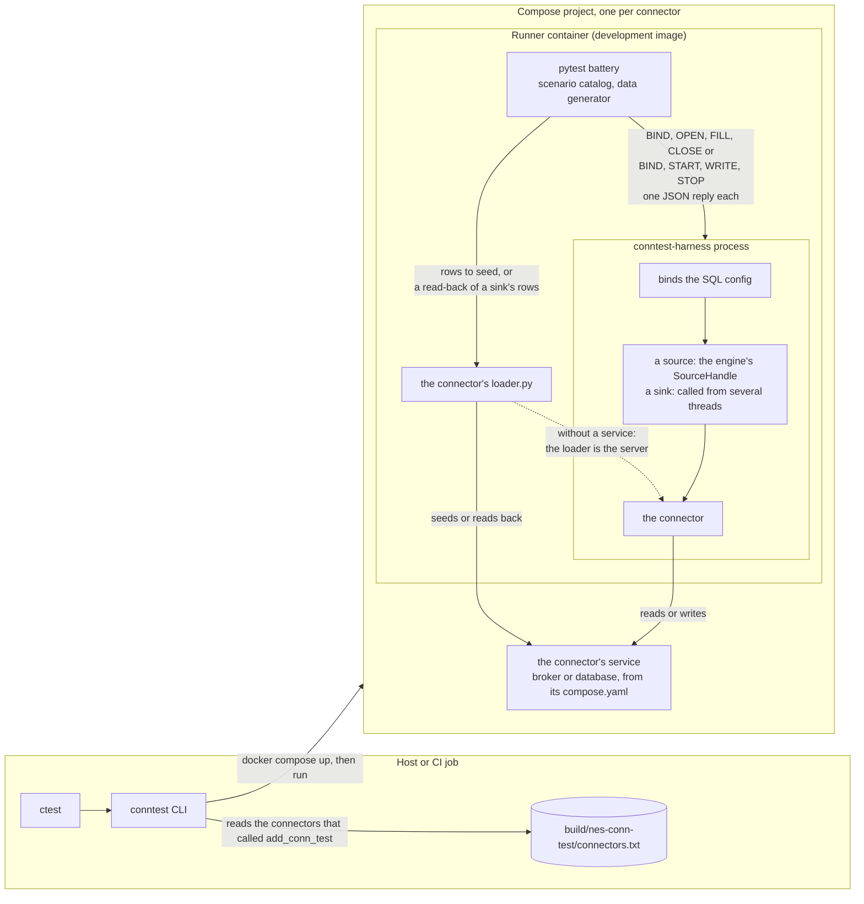

# ConnTest architecture



## Components

- **The CLI** (`runner/src/conntest_runner/cli.py`) runs each registered connector in its own compose project.
  It starts the connector's service, if the connector has a `compose.yaml`,
  runs pytest in a runner container on the same network, prints the logs on failure, and removes the project.
- **The runner** (`runner/`) is the pytest battery.
  For each scenario and config, it generates the rows from the config's schema and steps the harness.
  For a source, it seeds the rows through the loader and compares the bytes that the source delivered with them.
  For a sink, it gives the rows to the harness and compares them with what the loader reads back once the sink has stopped.
- **The harness** (`driver/`) runs one connector in its own process, so the runner can kill and respawn it.
  It binds the SQL config and creates the connector through the engine's registry.
  It runs a source in the engine's `SourceHandle`, so the source thread, backpressure and emit path are the engine's own.
  It calls a sink from several threads at once, as the engine's worker threads do,
  and repeats a buffer or a stop when the sink requests it, after the interval that the sink requests.
- **The loader** (`conn-test/loader.py` of each connector) is the only connector-specific code.
  It writes the rows to the connector's service, or, for a sink, reads back what the sink wrote there.
  A connector without a service, such as `TCPSource` or `TCPSink`, has no `compose.yaml`;
  its loader is the server that the connector connects to, inside the runner container.

## Harness protocol

The runner listens on a unix socket, and the harness connects to it.
Each command is one line, and each reply is one JSON line:

```
BIND                     bind the config and reply with its bound schema, for which the runner generates the rows
OPEN                     create the connector and start its source thread, which waits for the first FILL
FILL <n_rows> <n_bytes>  let the source read until <n_bytes> arrived or the stream ended; `FILL 0 0` returns once the connector is in a read
CLOSE                    stop the source thread, which closes the connector
```

A FILL reply also lists how long each read that returned a partly filled buffer took (`partial_read_ms`),
measured by the harness around the connector's `fillTupleBuffer`, so a scenario can check the flush interval.
A failure reply has the error's origin, code, name and phase, for example
`{"ok":false,"phase":"open","origin":"connector","code":4002,"name":"CannotOpenSource","message":"..."}`.
A scenario may expect a connector error; a harness error, such as a config that does not bind or a step timeout, always fails it.
Each step has a timeout of 30 s, and the runner kills a harness that exceeds the test's deadline of 120 s.
Neither can be configured: both only break stalls, so a longer one would only make a failing test slower.
Stopping a source has the step timeout too. A connector that ignores the stop request fails the step with `StepTimeout`,
and the harness then exits with code 3, because the stuck source thread still uses its state.
The bytes of each FILL go to the file in `--observed-path`, where the runner reads them back.

A sink session (`--mode=sink`) has its own commands:

```
BIND                     bind the config and reply with its bound schema, as for a source
START                    pack the input's records into buffers, create the sink and start it; the reply has `n_buffers`
WRITE <n_buffers>        hand the next <n_buffers> buffers to the sink, from `--threads` threads at once
STOP                     stop the sink, which delivers what it still holds or fails
```

The engine compiles the output formatter into the query, so a sink only receives formatted bytes.
The harness reads them as JSONL records from `--input-path` and packs whole records into buffers of `--buffer-size` bytes.
Each buffer has its own sequence number, because a sink keeps track of the buffers that it holds back by that number.
BIND rejects a sink config whose output format is not JSON, since the records are JSON.

## One round trip

1. The runner writes the test's endpoint into a copy of the config.
2. It starts the harness, generates the rows for the schema of the `BIND` reply, and the loader prepares the service.
3. `OPEN` creates the connector, which connects to the service.
4. The loader writes the rows, and `FILL` collects them from the source.
5. The runner compares the collected rows with the generated ones, ignoring their order.
6. `CLOSE` stops the source.

For a sink, the runner writes the rows that it generated for the schema of the `BIND` reply to the harness's input file, which the harness reads at `START`.

1. `START` creates the sink, which connects to the service.
2. `WRITE` hands every buffer to the sink.
3. `STOP` returns once the sink has delivered everything, or with its error.
4. The loader reads back what arrived, and the runner compares it with the generated rows, ignoring their order.
