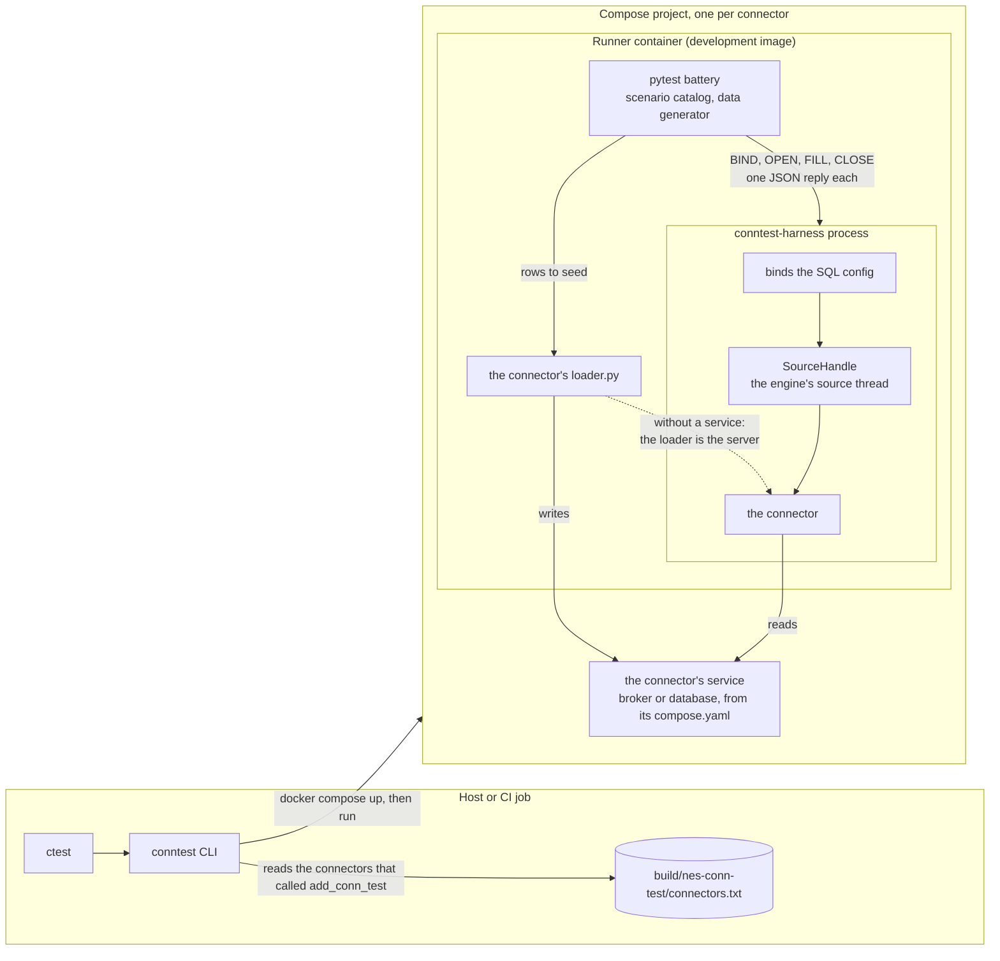

# ConnTest architecture



## Components

- **The CLI** (`runner/src/conntest_runner/cli.py`) runs each registered connector in its own compose project.
  It starts the connector's service, if the connector has a `compose.yaml`,
  runs pytest in a runner container on the same network, prints the logs on failure, and removes the project.
- **The runner** (`runner/`) is the pytest battery.
  For each scenario and config, it generates the rows from the config's schema, seeds them through the loader,
  steps the harness, and compares the bytes that the source delivered with the generated rows.
- **The harness** (`driver/`) runs one connector in its own process, so the runner can kill and respawn it.
  It binds the SQL config and creates the source through the engine's registry.
  It runs the source in the engine's `SourceHandle`, so the source thread, backpressure and emit path are the engine's own.
- **The loader** (`conn-test/loader.py` of each connector) is the only connector-specific code.
  It writes the rows to the connector's service.
  A connector without a service, such as `TCPSource`, has no `compose.yaml`;
  its loader is the server that the connector connects to, on loopback inside the runner container.

## Harness protocol

The runner listens on a unix socket, and the harness connects to it.
Each command is one line, and each reply is one JSON line:

```
BIND                     bind the config
OPEN                     create the connector and start its source thread, which waits for the first FILL
FILL <n_rows> <n_bytes>  let the source read until <n_bytes> arrived or the stream ended; `FILL 0 0` returns once the connector is in a read
CLOSE                    stop the source thread, which closes the connector
```

A FILL reply also lists how long each read that returned a partly filled buffer took (`partial_read_ms`),
measured by the harness around the connector's `fillTupleBuffer`, so a scenario can check the flush interval without a timed window.
A failure reply has the error's origin, code, name and phase, for example
`{"ok":false,"phase":"open","origin":"connector","code":4002,"name":"CannotOpenSource","message":"..."}`.
A scenario may expect a connector error; a harness error, such as a config that does not bind or a step timeout, always fails it.
Each step has a timeout (`--step-timeout-ms`, 30 s), and the runner kills a harness that exceeds the test's deadline (120 s).
Stopping a source has the step timeout too. A connector that ignores the stop request fails the step with `StepTimeout`,
and the harness then exits with code 3, because the stuck source thread still uses its state.
The bytes of each FILL go to the file in `--observed-path`, where the runner reads them back.

## One round trip

1. The runner writes the test's endpoint into a copy of the config.
2. It starts the harness, and the loader prepares the service.
3. `OPEN` creates the connector, which connects to the service.
4. The loader writes the rows, and `FILL` collects them from the source.
5. The runner compares the collected rows with the generated ones, ignoring their order.
6. `CLOSE` stops the source.
