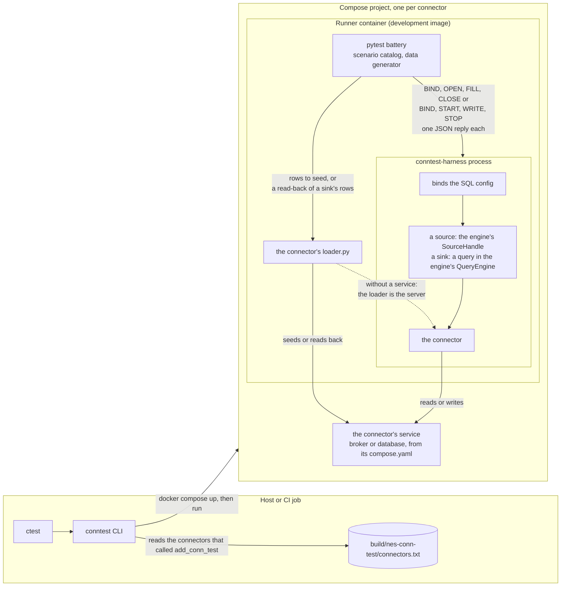

# ConnTest architecture



## Components

- **The CLI** (`runner/src/conntest_runner/cli.py`) runs each registered connector in its own compose project.
  It starts the connector's service, if the connector has a `compose.yaml`,
  runs pytest in a runner container on the same network, prints the logs on failure, and removes the project.
- **The runner** (`runner/`) is the pytest battery.
  For each scenario and config, it generates the rows for the schema in the harness's BIND reply and steps the harness.
  For a source, it seeds the rows through the loader and compares the bytes that the source delivered with them.
  For a sink, it gives the rows to the harness and compares them with what the loader reads back once the sink has stopped.
- **The harness** (`driver/`) runs one connector in its own process, so the runner can kill and respawn it.
  It binds the SQL config and creates the connector through the engine's registry.
  A source runs in the engine's `SourceHandle` but not in a query, so its source thread, backpressure and emit path are the engine's,
  and the harness takes each buffer that the source emits.
  A sink runs in a query in the engine's `QueryEngine`, fed by a source that reads the harness's input,
  so the worker threads, backpressure, repeats and the sink's start and stop are the engine's own.
- **The loader** (`conn-test/loader.py` of each connector) is the only connector-specific code.
  It writes the rows to the connector's service, or, for a sink, reads back what the sink wrote there.
  A connector without a service has no `compose.yaml`;
  its loader is the server that the connector connects to, inside the runner container.

## Harness protocol

The runner listens on a unix socket, and the harness connects to it.
Each command is one line, and each reply is one JSON line:

```
BIND                     bind the config and reply with its bound schema, for which the runner generates the rows, and the step timeout
OPEN                     create the connector and start its source thread, which waits for the first FILL
FILL <n_rows> <n_bytes>  let the source read until <n_bytes> arrived or the stream ended; `FILL 0 0` returns once the connector is in a read
CLOSE                    stop the source thread, which closes the connector
```

A FILL reply also lists how long each read that returned a partly filled buffer took (`partial_read_ms`),
measured by the harness around the connector's `fillTupleBuffer`, so a scenario can check the flush interval.
A failure reply has the error's origin, code, name and phase, for example
`{"ok":false,"phase":"open","origin":"connector","code":4002,"name":"CannotOpenSource","message":"..."}`.
A scenario may expect a connector error; a harness error, such as a config that does not bind or a step timeout, always fails it.
Each step has a timeout of 30 s, and the runner kills a harness that exceeds the test's deadline of 120 s.
The harness reports its step timeout at BIND, so that a step that the runner runs itself, such as a sink loader's read-back, waits as long without a second copy of the value.
Neither can be configured: both only break stalls, so a longer one would only make a failing test slower.
Stopping a source has the step timeout too. A connector that ignores the stop request fails the step with `StepTimeout`,
and the harness then exits with code 3, because the stuck source thread still uses its state.
At the end of a test, the harness stops a source that is still running when the runner closes the channel,
so the runner waits 40 s for the harness to exit before it kills it.
The bytes of each FILL go to the file in `--observed-path`, where the runner reads them back.

A sink session (`--mode=sink`) has its own commands:

```
BIND                     bind the config and reply with its bound schema, as for a source
START                    pack the input's records into buffers and run a query from the harness's source into a new sink; the reply has `n_buffers`
WRITE <n_buffers>        release the next <n_buffers> buffers to the source, and reply once the sink has taken them
STOP                     stop the query as a user does, which drops the buffers of a WRITE that has not returned
```

The query has the sink as its only pipeline, and `--threads` sets the engine's worker threads.
The harness learns from the engine's statistic events when the sink has taken a buffer:
a sink task that completes without repeating itself.
A failed query fails the step with the sink's error, which the engine reports unchanged.
A session that ends without STOP destroys the engine with the query still running, as a worker that shuts down does.
After a step timed out, an engine thread may still be in the sink, so the harness exits with code 3 when the session ends.

For a sink with the JSON output format, the engine compiles the output formatter into the query, so the sink receives formatted bytes.
The harness reads them as JSONL records from `--input-path` and lays them out in buffers of `--buffer-size` bytes as a query does:
a buffer takes records until its main buffer is full, and the record that crosses the end continues in a child buffer.
With 4096-byte buffers and records of 1000 bytes, a buffer holds four records and 96 bytes of the fifth, whose other 904 bytes are in a child.
The harness writes the bytes with the formatter's own function, so a sink that ignores child buffers loses data here as it does in a query.
The source reads the buffers in order, so the source thread gives each its own sequence number, as for any source.
BIND rejects a sink config whose output format is not JSON, since the records are JSON.

## One test

1. The runner writes the test's endpoint into a copy of the config.
2. It starts the harness, generates the rows for the schema of the `BIND` reply, and the loader prepares the service.
3. `OPEN` creates the connector, which connects to the service.
4. The loader writes the rows, and `FILL` collects them from the source.
5. The runner compares the collected rows with the generated ones, ignoring their order.
6. `CLOSE` stops the source.

For a sink, the runner writes the rows that it generated for the schema of the `BIND` reply to the harness's input file, which the harness reads at `START`.

1. `START` creates the sink, which connects to the service.
2. `WRITE` releases every buffer to the source, and the engine runs the sink with them.
3. `STOP` returns once the sink has delivered everything, or with its error.
4. The loader reads back what arrived, and the runner compares it with the generated rows, ignoring their order.
