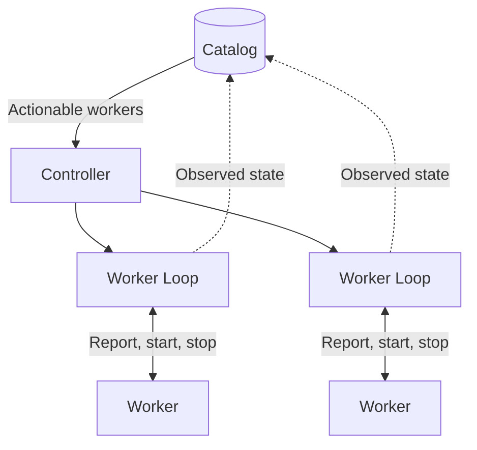

# Controller

The `controller` crate owns the runtime tasks that operate workers and their query fragments.  
For the coordinator's role, request flow, and general reconciliation model, see the [coordinator README](../README.md).

## Worker Loops

The controller runs one loop for each actionable worker, keyed by the worker's address.  
It starts a loop for every actionable worker that has none, and a loop ends once its worker is recorded as removed.

Each pass of a loop reads the worker's status report, then the worker's wanted fragments, which are its catalog rows that have not reached a terminal state.  
A pure function compares the two and returns the actions: start a fragment, stop a fragment, or record an observed state.  
A pass runs once per report interval, after a catalog change, and after a start returns.

The report lists every fragment that the worker runs, including those that are still compiling, and the fragments that terminated since the previous report.  
The loop keeps only what the report and the catalog cannot tell: the starts in flight, the failed starts in a row of each fragment, the time from which terminations are reported, and the missed reports in a row.

## Fragment Actions

| Worker reports                        | Desired state | Action                                                       |
|---------------------------------------|---------------|--------------------------------------------------------------|
| Nothing                               | Completed     | Start the fragment, unless a start is in flight              |
| Nothing                               | Stopped       | Record Stopped                                               |
| Starting or Running                   | Completed     | Record the state if it is ahead of the catalog               |
| Starting or Running                   | Stopped       | Record the state if it is ahead of the catalog, and stop it  |
| Terminated                            | Any           | Record Failed with an error, otherwise Stopped or Completed  |
| Starting or Running, but not wanted   | None          | Stop the fragment                                            |

A state is recorded only when it is ahead of the catalog's state, so a late or reordered report never moves a fragment back.  
A stop is repeated by every pass in which the worker still reports the fragment.

A start runs as a task of its own, so a long compile delays neither the reports nor the stops of the same worker.  
A start that fails permanently, or fails repeatedly, records the fragment as failed.

## Worker States

A worker whose report succeeds is recorded as active.  
A failed report, including a failed connection, counts as a missed health check, and the worker is recorded as unreachable after several misses in a row.

Removing a worker fails its fragments in the catalog, so the worker has no wanted fragments, and its loop stops every fragment that the worker still reports.  
Once the worker reports no running fragment, or misses several reports in a row, the loop records it as removed and ends.

## Communicating with Workers

The controller sends the same commands to every worker: start, stop, and report status.

Remote workers run outside the coordinator process and receive these commands through gRPC.  
The connection is made once per loop and dials again after the worker was unreachable.

Embedded workers run inside the coordinator process, so the same commands are direct in-process calls.  
An embedded worker is created when its loop connects, and its report is the same protocol message that a remote worker sends.
