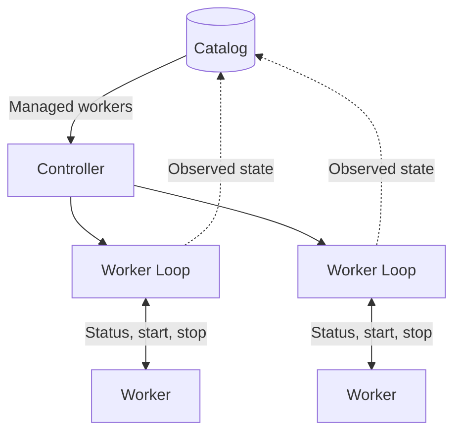

# Controller

The `controller` crate owns the loops that operate workers and their query fragments.  
For the coordinator's role, request flow, and general reconciliation model, see the [coordinator README](../README.md).

## Worker Loops

The controller runs one loop for each managed worker, keyed by the worker's address.  
It starts a loop for every managed worker that has none, and a loop ends once its worker is recorded as removed.

Each round of a loop reads the worker's status, then the worker's managed fragments, which are its catalog rows that have not reached a terminal state.  
A pure function compares the two and returns the corrections: start a fragment, stop a fragment, or record an observed state.  
A round runs once per status interval, after a catalog change, and after a start returns.

The status lists every fragment that the worker runs, including those that are still compiling, and the fragments that terminated since the previous status.  
The loop keeps only what the status and the catalog cannot tell: the calls in flight and the time from which terminations are listed.

## Fragment Corrections

| Worker lists                          | Desired state | Correction                                                   |
|---------------------------------------|---------------|--------------------------------------------------------------|
| Nothing                               | Completed     | Start the fragment, unless a start is in flight              |
| Nothing                               | Stopped       | Record Stopped                                               |
| Started or Running                    | Completed     | Record the state if it is ahead of the catalog               |
| Started or Running                    | Stopped       | Record the state if it is ahead of the catalog, and stop it  |
| Terminated                            | Any           | Record Failed with an error, otherwise Stopped or Completed  |
| Started or Running, but not managed   | None          | Stop the fragment                                            |

A state is recorded only when it is ahead of the catalog's state, so a late or reordered status never moves a fragment back.  
A stop is repeated by every round in which the worker still lists the fragment, unless the previous stop is still in flight.

Every start and stop runs as a task of its own, so a long compile or a slow stop delays neither the status requests nor the other calls to the same worker.  
A start repeats a transient failure after one status interval, and a start that fails permanently, or too often, records the fragment as failed.

## Worker States

A worker that answers a status request is recorded as active.  
A failed status request, including a failed connection, is repeated after one status interval, and the worker is recorded as unreachable once several requests in a row fail.

Removing a worker fails its fragments in the catalog, so the worker has no managed fragments, and its loop stops every fragment that the worker still lists.  
Once the worker lists no running fragment, or fails several status requests in a row, the loop records it as removed and ends.

## Communicating with Workers

The controller sends the same commands to every worker: start, stop, and get status.

Remote workers run outside the coordinator process and receive these commands through gRPC.  
The connection is made once per loop and reconnects after the worker was unreachable.

Embedded workers run inside the coordinator process, so the same commands are direct in-process calls.  
An embedded worker is launched when its loop connects, and its status is the same protocol message that a remote worker sends.
