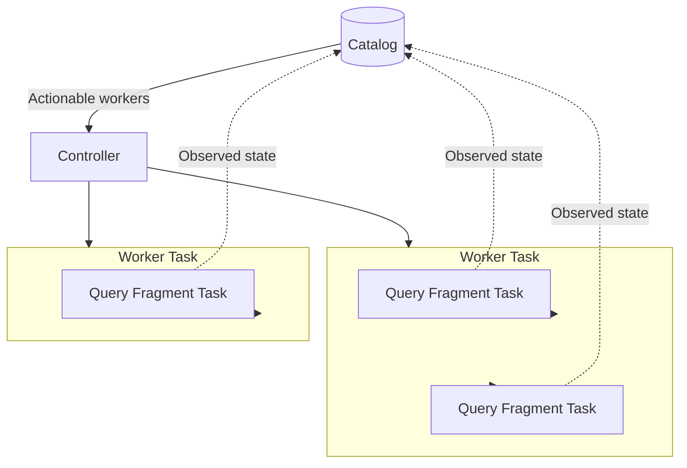

# Controller

The `controller` crate owns the runtime tasks that operate workers and query fragments.  
For the coordinator's role, request flow, and general reconciliation model, see the [coordinator README](../README.md).

## Task Hierarchy

The controller maintains one task for each worker that requires action.  
Each worker task maintains the tasks for the query fragments assigned to that worker.

Tasks are keyed by worker address or query fragment identifier.  
At most one task for a given key runs at a time.

## Worker Tasks

The top-level controller reads actionable worker rows and handles them according to their desired state.

- An active worker gets a worker task if none is already running for its address.
- A worker marked for removal has its task aborted before the catalog records it as removed.

A worker task connects to its worker, records whether it is active or unreachable, and manages the fragments assigned to it.  
After a remote connection is lost, the task discards its fragment tasks, marks the worker unreachable, and enters the connection loop again.  
The next successful connection reconstructs fragment tasks from the catalog.

## Query Fragment Tasks

Each query fragment task controls one fragment on its assigned worker.  
To start the fragment, it loads the fragment’s execution plan from the catalog, adds its identifier, and sends it to the worker.  
It can then ask the worker to stop the fragment or report its current status.

The fragment task chooses its next action from the desired and observed states:

| Desired state | Observed state | Action |
| --- | --- | --- |
| Completed | Pending | Start the fragment |
| Completed | Started or Running | Read its status |
| Stopped | Any non-terminal state | Request a stop, then read status until terminal |
| Completed or Stopped | Completed, Stopped, or Failed | Finish the task |

The controller keeps the catalog synchronized with the fragment states reported by workers.

## Communicating with Workers

The controller sends the same fragment commands to every worker: start, stop, and report status.

Remote workers run outside the coordinator process and receive these commands through gRPC.  
It monitors the connection, reconnects when it is lost, and retries temporary communication failures.

Embedded workers run inside the coordinator process, so the same commands are made through direct in-process calls instead of the network.

If a fragment command repeatedly fails or returns a permanent error, the controller records the fragment as failed in the catalog.
