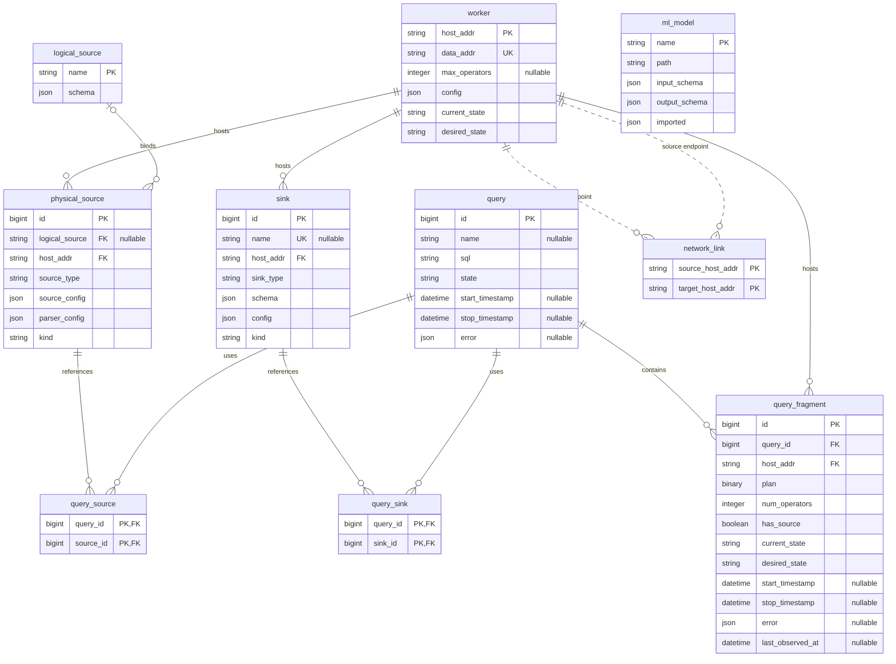

# Migrations

The `migration` crate contains the coordinator catalog schema as a sequence of SeaORM migrations.    
A migration is an ordered change to the database schema that can create or alter tables, indexes, and triggers.   
The coordinator applies pending migrations when it opens the catalog.  
The CLI below provides commands for running them manually.

## Catalog Schema

The catalog stores the coordinator state across the tables shown below. Solid connections represent foreign key relationships. The dotted connections show the worker addresses used by `network_link`, which are not enforced through foreign keys.

`PK` identifies a primary key, `FK` a foreign key, and `UK` a unique key. Fields marked as nullable do not require a value.



## Relationship with the Model

The `migration` and `model` crates work with the same catalog at different levels.


`migration` defines how catalog data is stored and which rules the database enforces, while `model` provides the Rust types and operations for reading and changing that data. 

Changes to catalog tables and columns must be reflected in both crates.  
`migration` defines the database structure, while `model` provides the corresponding Rust types and read and write operations.  
By contrast, adding an operation that uses data already stored in the catalog only requires a `model` change.  
For example, an operation that retrieves failed queries can use the existing query state and does not need a migration.

## Schema Changes

Changes to the catalog schema or its database rules are introduced through migrations.  
Once released, a migration remains unchanged.  
The catalog records each applied migration and does not run it again.  

A schema change accounts for:

- Preservation or deliberate transformation of existing catalog data.
- The same final schema whether the catalog is created from scratch or upgraded from an earlier version.
- Corresponding model changes when the stored representation changes.
- Rollback behavior when the change can be safely reversed.

For example, adding a required field involves defining its value for existing records, exposing it through the model, and defining how the schema change is reversed.

## Running Migrator CLI

- Generate a new migration file
    ```sh
    cargo run -- generate MIGRATION_NAME
    ```
- Apply all pending migrations
    ```sh
    cargo run
    ```
    ```sh
    cargo run -- up
    ```
- Apply first 10 pending migrations
    ```sh
    cargo run -- up -n 10
    ```
- Rollback last applied migrations
    ```sh
    cargo run -- down
    ```
- Rollback last 10 applied migrations
    ```sh
    cargo run -- down -n 10
    ```
- Drop all tables from the database, then reapply all migrations
    ```sh
    cargo run -- fresh
    ```
- Rollback all applied migrations, then reapply all migrations
    ```sh
    cargo run -- refresh
    ```
- Rollback all applied migrations
    ```sh
    cargo run -- reset
    ```
- Check the status of all migrations
    ```sh
    cargo run -- status
    ```
