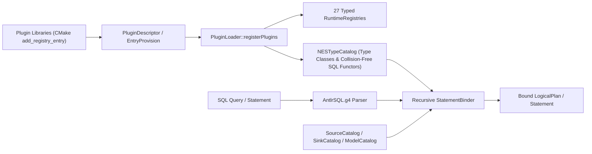

# Extensible Internal Type System, Plugin Registry Integration & Recursive SQL Binder

## 1. Architectural Overview

NebulaStream's frontend and plugin infrastructure now share a unified, extensible compile-time/bind-time type system that allows plugins to introduce first-class types (such as ML models, parameterized scalar type constructors, anonymous sources/sinks, and table-valued operators), constrain polymorphic functions via type classes, and bind SQL queries through explicit recursive-descent calls rather than ANTLR parse-tree listeners.

> [!IMPORTANT]
> Both the legacy ANTLR listener-stack query binder (`AntlrSQLQueryParser` / `AntlrSQLQueryPlanCreator`) and the deferred model-name placeholder pass (`InferModelNameLogicalOperator` + `InferModelResolutionRule`) have been completely removed. All 7 frontend, CLI, REPL, `nes-conn-test`, and `systest` call sites bind directly through [StatementBinder.hpp](file:///workspaces/nes1/nes-sql-parser/include/SQLQueryParser/StatementBinder.hpp).

---

## 2. Core Type System & Plugin Infrastructure (`nes-common`, `cmake`)

- **Concept + Wrapper Type Erasure (`detail::Erased*` + `detail::*Model<T>`)**: Implemented in [NESType.hpp](file:///workspaces/nes1/nes-common/include/Types/NESType.hpp) and [NESType.cpp](file:///workspaces/nes1/nes-common/src/Types/NESType.cpp) following the same concept-based type-erasure idiom as `LogicalOperator` and `LogicalFunction`:
  - `NESTypeConcept<T>` & `NESType`: Concrete types implement `operator==` and optionally `construct(const InstantiatedNESValueParameters&)` or `construct(const NESValueParameters&)` (alongside `getExpectedValueArguments()` or `using ValueType = ValueRepr;`). `NESType` wraps `detail::NESTypeModel<T>` (`tryGetAs<T>()`) alongside an open `TypeTraitMap` (`withTypeTrait<TypeTrait>()`, `tryGetTypeTrait<TypeTrait>()`, `hasTypeTrait<TypeTrait>()`), explicitly distinguished from IR optimizer `Trait`s / `TraitSet`.
  - `NESValue`: Immutable flyweight (`std::shared_ptr<const detail::NESValueImpl>`) pairing an instantiated `NESType` with a type-erased `ExplicitAny` representation ([Any.hpp](file:///workspaces/nes1/nes-common/include/Util/Any.hpp)).
  - `NESTypeClassConcept<T>`, `NESTypeClass`, `NESParametrizedTypeClassConcept<T>`, & `NESParametrizedTypeClass`: Concept-backed flyweight wrappers over predicates (`validate(const NESType&) -> bool`) and parameterized type-class constructors (`instantiate(const InstantiatedNESTypeParameters&) -> std::expected<NESTypeClass, Exception>`), supporting `NESTypeClass::forTypeTrait<TypeTrait>()`, boolean combinators (`&&`, `||`), and higher-kinded structural predicates (`ClosedBinaryFunction(Add)`).
  - `NESFunctorConcept<T>`, `NESFunctor`, `NESTypeParameter` / `NESOptionalTypeParameter` / `NESFunctorParameter` / `NESOptionalFunctorParameter` / `NESNonTypeParameter<T>` / `NESValueParameter<T>`, & `InstantiatedNESTypeParameters` / `InstantiatedNESValueParameters`: Mirroring `ConfigField<T>` and `InstantiatedConfig`, plugin authors declare each type, higher-kinded functor, non-type, or value parameter once (`createExpectedNESTypeArguments(...)` / `createExpectedNESValueArguments(...)`) and retrieve validated, typed parameters directly via `params.get(PARAM)` without repeating `QualifiedIdentifier` strings.
- **Thread-Safe Catalog & Plugin Registration**:
  - [NESTypeCatalog.hpp](file:///workspaces/nes1/nes-common/include/Types/NESTypeCatalog.hpp) and [NESTypeCatalog.cpp](file:///workspaces/nes1/nes-common/src/Types/NESTypeCatalog.cpp) maintain `std::shared_mutex`-synchronized maps of parameterized type classes, per-registry functors, and collision-free SQL-exposed functors.
  - [RuntimeRegistry.hpp](file:///workspaces/nes1/nes-common/include/Util/RuntimeRegistry.hpp), [PluginDescriptor.hpp](file:///workspaces/nes1/nes-common/include/Plugins/PluginDescriptor.hpp), [PluginLoader.cpp](file:///workspaces/nes1/nes-common/src/Plugins/PluginLoader.cpp), and [RuntimeRegistrationUtil.cmake](file:///workspaces/nes1/cmake/RuntimeRegistrationUtil.cmake) register every plugin entry simultaneously into its typed C++ `RuntimeRegistry` and `NESTypeCatalog`, failing fast with `CannotLoadPlugin` on any SQL-scope name collision.

---

## 3. Plugin Registry Integration & Polymorphic Constraints

All **27** `RuntimeRegistry` instances across the codebase (23 domain registries + 4 internal `*UnreflectionRegistry` instances) are integrated with the type system:

| Component | Registries | Exposed Type Classes | SQL Scope & Polymorphic Capabilities |
| :--- | :--- | :--- | :--- |
| `nes-data-types` | [DataTypeRegistry.hpp](file:///workspaces/nes1/nes-data-types/registry/include/DataTypeRegistry.hpp), [ScalarTypes.hpp](file:///workspaces/nes1/nes-data-types/include/DataTypes/ScalarTypes.hpp) | `ScalarDatatype`, `NumericDatatype`, `IntegerDatatype`, `FloatDatatype` | `EXPOSE_TO_SQL_SCOPE = true`; `EntryType = NESFunctor`; distinct C++ `NESType` classes for each scalar (`BooleanType`, `CharType`, `Int8Type`..`Int64Type`, `UInt8Type`..`UInt64Type`, `Float32Type`, `Float64Type`, `VarSizedType`, `UndefinedType`) with typed C++ `NESValue` payloads and marker traits (`ScalarTypeTrait`, `NumericTypeTrait`, `IntegerTypeTrait`, `FloatTypeTrait`), composed with `OptionalType` (`OPTIONAL(INNER_TYPE: ScalarDatatype)`) and bridged to IR `DataType` via `LegacyDataTypeTrait` |
| `nes-sources` | [SourceConfigSchemaRegistry.hpp](file:///workspaces/nes1/nes-sources/registry/include/SourceConfigSchemaRegistry.hpp), [SourceRegistry.hpp](file:///workspaces/nes1/nes-sources/registry/include/SourceRegistry.hpp), [SourceConfigRegistry.hpp](file:///workspaces/nes1/nes-sources/registry/include/SourceConfigRegistry.hpp) | `Source`, `SourceConfigSchema`, `PhysicalSource`, `SourceConfig` | `SourceConfigSchemaRegistry` exposes `*Source` (`FileSource`, `NetworkSource`, `GeneratorSource`, `MQTTSource`, `TCPSource`) with `SourceTypeTrait` constructing `BoundAnonymousSource` |
| `nes-sinks` | [SinkConfigSchemaRegistry.hpp](file:///workspaces/nes1/nes-sinks/registry/include/SinkConfigSchemaRegistry.hpp), [SinkRegistry.hpp](file:///workspaces/nes1/nes-sinks/registry/include/SinkRegistry.hpp), [SinkConfigRegistry.hpp](file:///workspaces/nes1/nes-sinks/registry/include/SinkConfigRegistry.hpp) | `Sink`, `SinkConfigSchema`, `PhysicalSink`, `SinkConfig` | `SinkConfigSchemaRegistry` exposes `*Sink` (`FileSink`, `PrintSink`, `NetworkSink`, `ChecksumSink`, `VoidSink`, `TCPSink`, `MQTTSink`, `KafkaSink`) with `SinkTypeTrait` constructing `BoundAnonymousSink` |
| `nes-logical-operators` | [LogicalFunctionRegistry.hpp](file:///workspaces/nes1/nes-logical-operators/registry/include/LogicalFunctionRegistry.hpp) | `LogicalFunction`, `ClosedBinaryFunction` | `EXPOSE_TO_SQL_SCOPE = true`; every scalar `LogicalFunction` exposes `static NESFunctor functor()` backed by pure type-level `inferResultType(...)` (`UnaryTypeInferenceFn` / `BinaryTypeInferenceFn` / `VariadicTypeInferenceFn` with zero dummy `Field`/`Schema` probing), and higher-kinded `ClosedBinaryFunction(Add)` (`NESFunctorParameter`) validates `(W, W) -> W` over built-in and plugin scalar types |
| `nes-logical-operators` | [AggregationLogicalFunctionRegistry.hpp](file:///workspaces/nes1/nes-logical-operators/registry/include/AggregationLogicalFunctionRegistry.hpp) | `AggregationLogicalFunction` | `EXPOSE_TO_SQL_SCOPE = true`; all 6 aggregations expose `static NESFunctor functor()` backed by pure type-level `inferAggregateType(const NESType&)`; [SumAggregationLogicalFunction.cpp](file:///workspaces/nes1/nes-logical-operators/src/Operators/Windows/Aggregations/SumAggregationLogicalFunction.cpp) constrains `INPUT_TYPE` via `ClosedBinaryFunction(AddLogicalFunction::functor())` |
| `nes-logical-operators` | [ModelRegistry.hpp](file:///workspaces/nes1/nes-logical-operators/registry/include/ModelRegistry.hpp) | `ML_MODEL` (`MLModelTypeTraitConcept` / `MLModelTypeTrait`) | `EXPOSE_TO_SQL_SCOPE = true`; registers `OPENVINO_MODEL(PATH, INPUT, OUTPUT)` alongside open support for alternative backends (e.g., `IREE_MODEL`) |
| `nes-logical-operators` | [LogicalOperatorRegistry.hpp](file:///workspaces/nes1/nes-logical-operators/registry/include/LogicalOperatorRegistry.hpp) | `LogicalOperator` (`LogicalOperatorTypeTrait`) | `EXPOSE_TO_SQL_SCOPE = true`; registers `MODEL_INFERENCE(MODEL: ML_MODEL, STREAM: LogicalOperator)` in [InferModelLogicalOperator.cpp](file:///workspaces/nes1/nes-logical-operators/src/Operators/InferModelLogicalOperator.cpp) |
| Formatters, Physical Ops & Optimizer | `InputFormatIndexerRegistry`, `InputFormatterConfig*`, `ValueDeserializerRegistry`, `OutputFormatter*`, `ValueSerializerRegistry`, `PhysicalFunctionRegistry`, `AggregationPhysicalFunctionRegistry`, `LoweringRuleRegistry`, `PlanRuleRegistry` | `InputFormatter`, `InputFormatterConfig`, `InputFormatterConfigSchema`, `ValueDeserializer`, `OutputFormatter`, `OutputFormatterConfig`, `OutputFormatterConfigSchema`, `ValueSerializer`, `PhysicalFunction`, `AggregationPhysicalFunction`, `LoweringRule`, `PlanRule` | Internal (`EXPOSE_TO_SQL_SCOPE = false`) nullary functors registered in `NESTypeCatalog` |
| Unreflection | `LogicalFunctionUnreflectionRegistry`, `AggregationLogicalFunctionUnreflectionRegistry`, `LogicalOperatorUnreflectionRegistry`, `PhysicalFunctionUnreflectionRegistry` | None (`0` type classes) | Serialization-only `UnreflectionRegistry` instances |

---

## 4. Grammar, Unified Recursive `StatementBinder` & SQL Syntax Migrations

- **Grammar ([AntlrSQL.g4](file:///workspaces/nes1/nes-sql-parser/AntlrSQL.g4))**:
  - 8-tier expression precedence, parenthesized and unparenthesized multi-column `GROUP BY`, `BINARY_WINDOW` for binary join windows vs. `WINDOW` for unary window aggregations, `SCHEMA(...)` literals, parameterized `typeDefinition` (`OPTIONAL(INT32)`, `FixedSizeArray(INT32, 4)`), curried `functionCall` callees, and `CREATE MODEL` / `SHOW` / `DROP` / `EXPLAIN`.
- **Recursive Query & Statement Binding ([StatementBinder.cpp](file:///workspaces/nes1/nes-sql-parser/src/StatementBinder.cpp))**:
  - Lexical `NestedScope` seeded from `NESTypeCatalog::instance().getAllSqlFunctors()` and `ModelCatalog` (without shadowing stream column names in scalar clauses), plus scoped unary/binary `TUMBLING` and `SLIDING` window functors.
  - Full binder-side configuration resolution for named and anonymous sources/sinks ([AnonymousSourceLogicalOperator.hpp](file:///workspaces/nes1/nes-logical-operators/include/Operators/Sources/AnonymousSourceLogicalOperator.hpp), [AnonymousSinkLogicalOperator.hpp](file:///workspaces/nes1/nes-logical-operators/include/Operators/Sinks/AnonymousSinkLogicalOperator.hpp), [QueryDecomposition.cpp](file:///workspaces/nes1/nes-query-optimizer/src/Placement/QueryDecomposition.cpp), [LowerToPhysicalSource.cpp](file:///workspaces/nes1/nes-query-compiler/src/LoweringRules/LowerToPhysical/LowerToPhysicalSource.cpp)).
  - Streaming multi-statement API (`parseAndBindEach`) used across [StatementHandler.cpp](file:///workspaces/nes1/nes-frontend/src/Statements/StatementHandler.cpp), [CLIStarter.cpp](file:///workspaces/nes1/nes-frontend/apps/cli/CLIStarter.cpp), [Repl.cpp](file:///workspaces/nes1/nes-frontend/apps/repl/Repl.cpp), [ReplStarter.cpp](file:///workspaces/nes1/nes-frontend/apps/repl/ReplStarter.cpp), [Binder.cpp](file:///workspaces/nes1/nes-conn-test/driver/Binder.cpp), and [SystestBinder.cpp](file:///workspaces/nes1/nes-systests/systest/src/SystestBinder.cpp).
- **`Systest` Rewriter & Corpus Migration**:
  - Updated [SqlParse.cpp](file:///workspaces/nes1/nes-systests/systest/src/Rewriter/SqlParse.cpp), [SourceRewriting.cpp](file:///workspaces/nes1/nes-systests/systest/src/Rewriter/SourceRewriting.cpp), [SinkRewriting.cpp](file:///workspaces/nes1/nes-systests/systest/src/Rewriter/SinkRewriting.cpp), [NamePrefixer.cpp](file:///workspaces/nes1/nes-systests/systest/src/Rewriter/NamePrefixer.cpp), [Emitter.cpp](file:///workspaces/nes1/nes-systests/systest/src/Rewriter/Emitter.cpp), and [DataStaging.cpp](file:///workspaces/nes1/nes-systests/systest/src/Runner/DataStaging.cpp) (including recursive rewriting of nested `MODEL_INFERENCE(...)`, inline `OPENVINO_MODEL(...)` relative paths, and nested inline `FileSource(...)` calls).
  - Migrated 235+ SLT files (`.test`, `.dummy`, `.test.disabled`), `.sql`, `.nesql`, `.yaml`, `.bats`, and CI workflow files, and added end-to-end tests for inline `OPENVINO_MODEL(...)` ([InferModelMNIST.test](file:///workspaces/nes1/nes-systests/inference/InferModelMNIST.test), [InferModel.test](file:///workspaces/nes1/nes-systests/inference/InferModel.test)) and the `OPTIONAL(...)` type functor ([OptionalTypeFunctor.test](file:///workspaces/nes1/nes-systests/datatype/OptionalTypeFunctor.test)).

---

## 5. Verification & Carbon Review Summary

> [!TIP]
> Two independent Carbon subagent reviews were conducted: an architecture/plan review ([1f35b112](conversation://1f35b112-1cf2-43ba-a528-8f668ed0fbc4)) prior to implementation and an adversarial max-effort final code review ([1d831bbf](conversation://1d831bbf-7c35-442b-a438-b17abaa96129)) across all touched files.

### Findings Resolved from Final Max-Effort Carbon Review
1. **Nested `MODEL_INFERENCE` & Inline Source Rewriting**: Made `catalogReferencesInFrom` and `anonymousSourcesInFrom` in [SqlParse.cpp](file:///workspaces/nes1/nes-systests/systest/src/Rewriter/SqlParse.cpp) recurse through nested `FunctionCallContext` arguments and added `RewritesNestedModelInferenceAndNestedInlineFileSource` in [TestFilePreparerTests.cpp](file:///workspaces/nes1/nes-systests/systest/tests/Rewriter/TestFilePreparerTests.cpp).
2. **Flyweight Copy-Equality (`copy == orig`)**: Wrapped `NESValue`, `NESTypeClass`, `NESParametrizedTypeClass`, and `NESFunctor` in immutable `std::shared_ptr` flyweights in [NESType.hpp](file:///workspaces/nes1/nes-common/include/Types/NESType.hpp) and cached nullary registry `NESType` instances in [PluginDescriptor.hpp](file:///workspaces/nes1/nes-common/include/Plugins/PluginDescriptor.hpp).
3. **Config Formatter Peeking & Duplicate Key Detection**: Added unqualified `TYPE` fallback when peeking `INPUT_FORMATTER.TYPE` / `OUTPUT_FORMATTER.TYPE` and switched `bindConfigValues`, `makeSourceConfigSchemaFunctor`, and `makeSinkConfigSchemaFunctor` to `createConfigLiteralSchema(...)`.
4. **Catalog Model Scoping, Case-Sensitivity & `UnknownModelName`**: Prevented catalog models from shadowing stream columns in scalar clauses, preserved quoted model-name casing across `CREATE MODEL` / `DROP MODEL` / `CLIStarter`, and preserved `ErrorCode::UnknownModelName` (`2040`) when `MODEL_INFERENCE` receives an unregistered model identifier.
5. **Per-Scalar C++ Types, `NESValue`-Backed `ConstantValueLogicalFunction`, Curried Functors & `OptionalType` Nullability**: Replaced enum-multiplexed scalar types and `ScalarLiteralValue` with distinct C++ `NESType` structs ([ScalarTypes.hpp](file:///workspaces/nes1/nes-data-types/include/DataTypes/ScalarTypes.hpp)) carrying typed C++ payloads (`int32_t`, `float`, `std::string`, etc.) and `NumericTypeTrait` / `IntegerTypeTrait` / `FloatTypeTrait`, refactored [ConstantValueLogicalFunction.hpp](file:///workspaces/nes1/nes-logical-operators/include/Functions/ConstantValueLogicalFunction.hpp) and [FunctionProvider.cpp](file:///workspaces/nes1/nes-physical-operators/src/Functions/FunctionProvider.cpp) to wrap and lower a `ScalarDatatype`-validated `NESValue` directly without string round-tripping, modeled nullability orthogonally via `OptionalType` (`OPTIONAL(INNER_TYPE: ScalarDatatype)`), and enabled curried functor instantiation (`OPTIONAL(INT32)(42)`, `OPTIONAL(INT32)(NULL)`, `FixedSizeArray(INT32, 3)(10, 20, 30)`).
6. **Class-Level Function Functors & Pure Type-Level Expression Inference**: Added `static NESFunctor functor()` across all 36 scalar `LogicalFunction`s and all 6 `AggregationLogicalFunction`s, plus pure type-level `static std::expected<NESType, Exception> inferResultType(...)` / `inferAggregateType(...)` across all 31 SQL-callable scalar `LogicalFunction`s (including `nes-plugins/Functions/Conditional`) and all 6 `AggregationLogicalFunction`s — eliminating all dummy `SourceNameLogicalOperator` / `Field` / `Schema` / `try-catch` probing in [LogicalFunctionRegistry.cpp](file:///workspaces/nes1/nes-logical-operators/src/Functions/LogicalFunctionRegistry.cpp) and [AggregationLogicalFunctionRegistry.cpp](file:///workspaces/nes1/nes-logical-operators/src/Operators/Windows/Aggregations/AggregationLogicalFunctionRegistry.cpp) and unifying AST `withInferredDataType(schema)` / `withInferredType(schema)` with type-level functor instantiation.
7. **Thread Safety, Non-Throwing Lookup & Callback Propagation**: Added `std::shared_mutex` synchronization to `NESTypeCatalog` (with RAII cleanup in unit tests, verified with `--gtest_repeat=2`), restored non-throwing `std::nullopt` behavior in [DataTypeProvider.cpp](file:///workspaces/nes1/nes-data-types/src/DataTypes/DataTypeProvider.cpp), guarded `Schema::createCollisionString` for non-`DataType` fields in [Schema.hpp](file:///workspaces/nes1/nes-common/schema/include/Schema/Schema.hpp), confined `parseAndBindEach`'s `try/catch` to parsing so caller callback exceptions propagate cleanly, and updated [execute_query.yml](file:///workspaces/nes1/.github/workflows/execute_query.yml).

### Executed Test Suites
- **Core Type System & Registry Unit Tests**:
  - `nes-type-test --gtest_repeat=2` ([NESTypeTest.cpp](file:///workspaces/nes1/nes-common/tests/UnitTests/NESTypeTest.cpp)): **3/3 passed x 2**
  - `nes-type-system-test --gtest_repeat=2` ([NESTypeSystemTest.cpp](file:///workspaces/nes1/nes-logical-operators/tests/NESTypeSystemTest.cpp)): **3/3 passed x 2** (verifying all 27 domain type classes, `ClosedBinaryFunction("Add")`, `Sum` constraint, and polymorphic mock `IREE` backend)
  - `statement-binder-test --gtest_repeat=2` ([StatementBinderTest.cpp](file:///workspaces/nes1/nes-sql-parser/tests/StatementBinderTest.cpp)): **58/58 passed x 2**
- **Full CTest Unit Suite (`ctest -LE "Systest|DockerCompose"`)**: **1,195/1,195 passed (100%)**
- **End-to-End `systest` Suites**:
  - `systest_interpreter_HASH_JOIN_sliceCache_true`: **788/788 queries passed (0 failed)**
  - `systest_interpreter_NESTED_LOOP_JOIN_sliceCache_true`: **781/781 queries passed (0 failed)**
  - `slt-e2e-test`: **34/34 passed**
  - CLI (`nes-cli dump`) and Embedded REPL (`nes-repl-embedded -f JSON`, including exact 6-stage text & visual `EXPLAIN` comparisons against [embedded.bats](file:///workspaces/nes1/nes-frontend/apps/repl/tests/embedded.bats)): **100% exact match**
